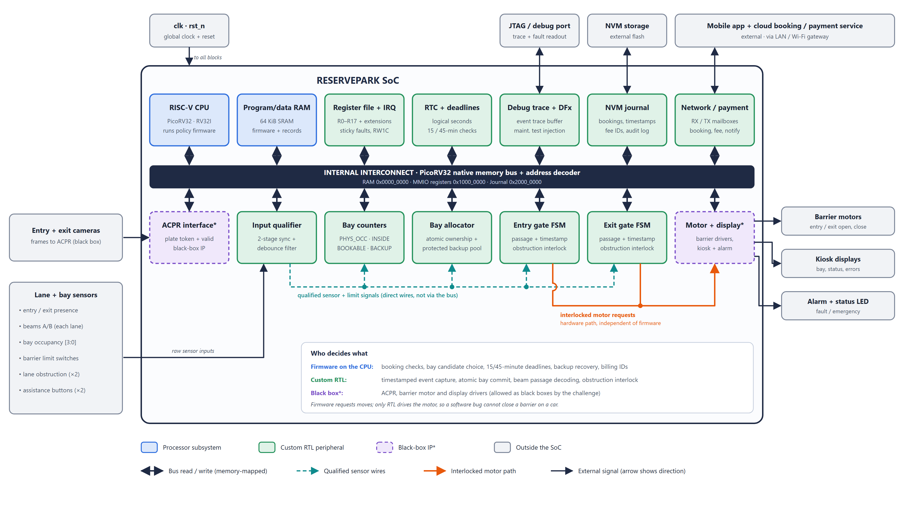
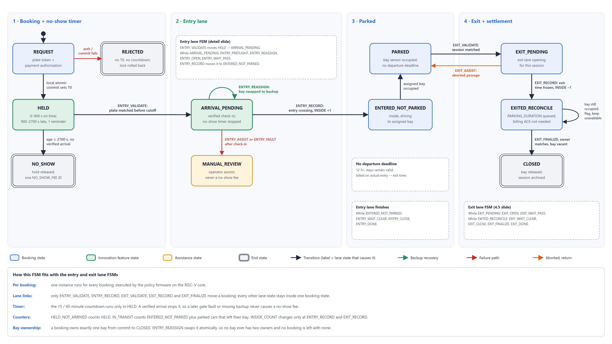
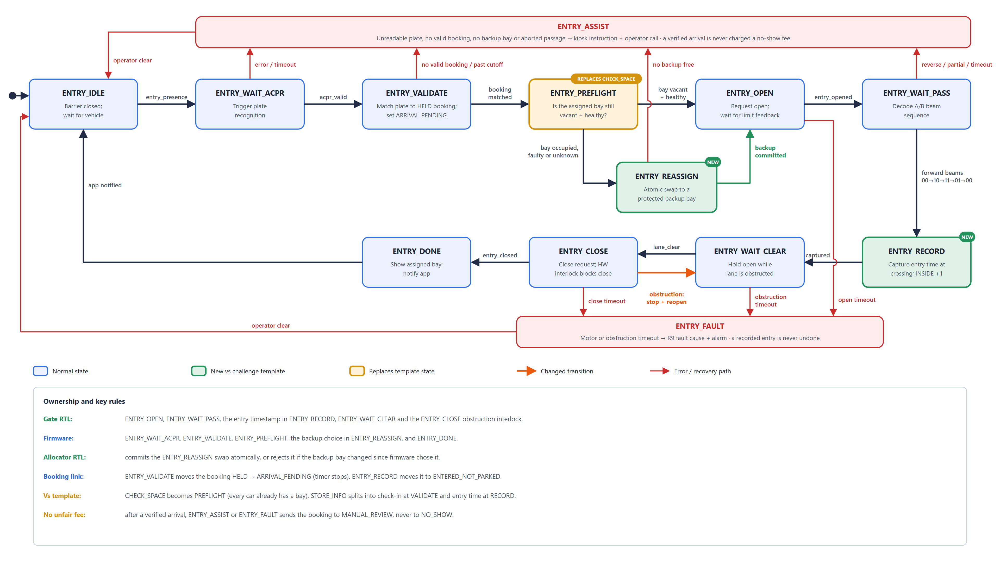
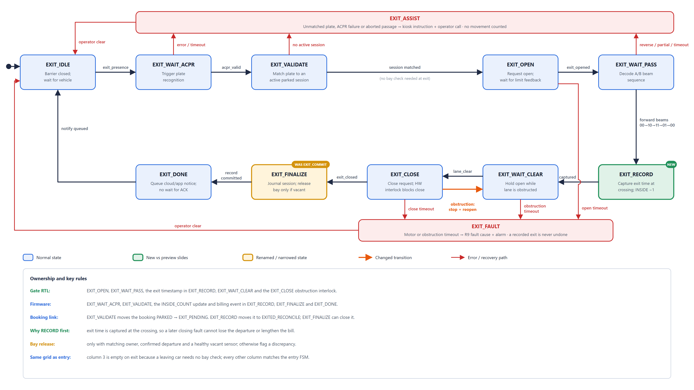

# ReservePark SoC

**A reservation-only smart car park System-on-Chip.** Intel University VLSI Bootcamp Series 2026, Smart Car Park challenge.

Every booking gets a specific bay, a fair arrival window, and an automatic recovery plan if that bay becomes unusable before the driver arrives.

This repository contains our **target design**, presented in the slides for challenge sections 4.1 to 4.7. It also contains a **simplified first-stage RTL simulation** that we built to validate the design's core rules early. The slide deck itself is submitted separately, as the challenge requires.

---

## Start here

| If you want to see | Go to |
| --- | --- |
| The challenge brief we answered | [challenge/Smart CarPark Challenge.pdf](challenge/Smart%20CarPark%20Challenge.pdf) |
| Our target design, in one document | [design/PRD.md](design/PRD.md) |
| Block diagram and FSM diagrams | [design/diagrams/](design/diagrams/) |
| **The simulation code we wrote for validation** | [simulation/](simulation/), starting with [simulation/README.md](simulation/README.md) |
| The test scenarios | [simulation/emu/scenarios/](simulation/emu/scenarios/) |
| The recorded test results | [simulation/BUILD_LOG.md](simulation/BUILD_LOG.md) |
| How to run the simulation yourself | [Section 4](#4-how-to-run-the-simulation) |

---

## Repository layout

```text
.
├── README.md                     you are here
│
├── challenge/                    inputs we were given
│   ├── Smart CarPark Challenge.pdf                     official brief and rubric
│   └── ReservePark_Flexible_Parking_Duration_Preview.pdf   our source slide deck (policy, R0–R17)
│
├── design/                       the target design (what the slides present)
│   ├── README.md                 index of design documents
│   ├── PRD.md                    requirements, architecture, FSMs, test catalogue
│   ├── register_map.md           R0–R17 field by field, address regions (4.4.2)
│   ├── diagrams/                 4.1 block diagram, booking / entry / exit FSMs (PNG + SVG + generator)
│   ├── slide_content.md          slide text for 4.1–4.7 (team working notes)
│   ├── requirements_and_simulation_review.md   requirements cross-check (working notes)
│   └── RESERVEPARK_RISCV_Coding_Agent_Brief.md  build brief for the full RISC-V version (next phase)
│
└── simulation/                   the code we simulated for validation
    ├── README.md                 what was built, how it maps to the design, code reading guide
    ├── BUILD_LOG.md              design decisions and recorded results
    ├── rtl/                      the simulated chip: 11 Verilog modules + shared defines
    ├── rtl_files.f               RTL file list
    ├── tb/                       12 unit benches, system bench with live invariant checks, models
    └── emu/
        ├── run.py                one-command test runner
        ├── scenarios/            16 directed test scenarios
        └── waves/                GTKWave presets for the slide waveforms
```

---

## 1. The target design

### Parking policy

- **Reservation only, booked now.** The driver books through an app with a plate number and payment authorisation. The chip immediately locks a vacant, healthy normal bay. There is no future time slot and no departure deadline.
- **T0 is the local commit.** The countdown starts when the chip commits the bay, and a retransmitted confirmation never restarts it.
- **15-minute grace, 45-minute no-show.** Arrival within 900 s is on time. Up to 2700 s is late but accepted, with one reminder. A booking with no verified arrival by 2700 s releases its hold and is charged one no-show fee.
- **A verified arrival stops the clock.** Verified means entrance presence plus a matching plate captured before the cutoff. If a gate fault or a missing backup then stops entry, the driver goes to manual review and is never charged a no-show fee.
- **Pay for actual time.** Billing uses the entry and exit crossing timestamps. A delayed or duplicated payment acknowledgement never changes the duration or creates a second charge.

### Advanced feature: protected backup bays

Some bays are a protected backup pool. In the 4-bay prototype, bays 0 to 2 are normal and bay 3 is the backup. Backups are never sold as ordinary bookings.

When a driver arrives and their bay has been taken, has failed or reads unknown, the chip atomically moves the booking to a free backup **before the barrier opens**. With no backup free, the gate stays closed and an operator assists.

### Architecture (slide 4.1)



- **Processor.** A RISC-V CPU (PicoRV32, RV32I) runs the policy firmware.
- **Custom RTL.** It handles the timing-critical and safety-critical work: timestamped event capture, atomic bay ownership, beam-based passage detection, and the obstruction interlock. Firmware can request barrier movement, but only hardware drives the motor.
- **External interfaces.** There are 64 pins: cameras, lane and bay sensors, barrier motors, kiosk displays, alarm, a network link, NVM flash and JTAG.

### State machines (slide 4.5)

Three aligned FSMs:

- **Booking FSM.** One instance per booking. States: REQUEST, HELD, ARRIVAL_PENDING, ENTERED_NOT_PARKED, PARKED, EXIT_PENDING, EXITED_RECONCILE, CLOSED, with NO_SHOW, REJECTED and MANUAL_REVIEW as exceptions.
- **Entry FSM.** It extends the challenge template. ENTRY_PREFLIGHT checks the booked bay is still usable, and ENTRY_REASSIGN performs the backup swap.
- **Exit FSM.** This is the required 4.5 answer. EXIT_RECORD captures the exit time at the crossing, before the barrier closes, so a closing fault can never lose a departure.

| Booking FSM | Entry FSM | Exit FSM |
| --- | --- | --- |
|  |  |  |

Registers R0 to R17 are listed field by field in [design/register_map.md](design/register_map.md). Interfaces, storage, the full test catalogue and DFx are specified in [design/PRD.md](design/PRD.md).

---

## 2. What we simulated for validation

The simulation is a **simplified first-stage model** of the controller. It keeps the design's rules but uses fewer stored states, so that every transition can be tested and covered. It is the code to read if you want to see how we validated the design.

| | Target design | Simulated model |
| --- | --- | --- |
| Policy decisions | RISC-V firmware | Hardwired control unit FSM |
| Booking record | 11 states | 5 states: HELD, ARRIVED, INSIDE, REVIEW, CLOSED |
| Each gate lane | Entry or exit FSM | Beam sequencer + motor FSM |
| Bay allocation and backup swap | Atomic allocator | Same: atomic allocator by normal / backup class |
| Obstruction interlock | Hardware gated | Same: close output gated by obstruction |
| Persistence | NVM journal | Not modelled |

**What it proves.** The tests cover the following behaviours:
- A taken bay is swapped to the backup before the gate opens.
- The barrier never closes on a blocked beam.
- No-shows are charged exactly once, at 2700 s.
- The 900 s and 2700 s boundaries behave as specified.
- A verified driver is never charged a no-show fee.
- Reverse crossings are not counted.
- Duplicated payment acknowledgements create one fee.

### Results, recorded 24 October 2026

| Check | Result |
| --- | --- |
| Unit benches | 12 / 12 PASS |
| System bench self-test, with invariants checked every cycle | PASS |
| Directed scenarios | 16 / 16 PASS |
| Booking FSM transitions exercised | 9 / 9 |
| Mutation checks: tests fail when the design is deliberately broken | 3 / 3 caught |

The full output is in [simulation/BUILD_LOG.md](simulation/BUILD_LOG.md), and you can reproduce it with one command (section 4).

**Where to read the code:** [simulation/README.md](simulation/README.md) has a reading guide pointing to the exact lines for the backup swap, the obstruction interlock, the no-show deadline, and the invariant checks.

---

## 3. How the simulation maps to the design

| Target booking state | Simulated state |
| --- | --- |
| HELD | HELD |
| ARRIVAL_PENDING | ARRIVED |
| ENTERED_NOT_PARKED, PARKED, EXIT_PENDING | INSIDE; parked or moving is read from the bay sensor |
| EXITED_RECONCILE | The allocator keeps the bay owned until its sensor reads vacant |
| CLOSED, NO_SHOW | CLOSED, with the reason carried by the fee or duration message |
| MANUAL_REVIEW | REVIEW, cleared by operator retry or resolve |

| Target lane states | Simulated block |
| --- | --- |
| WAIT_ACPR, VALIDATE, PREFLIGHT, REASSIGN | One control-unit pass over the camera event |
| OPEN, WAIT_CLEAR, CLOSE | Motor FSM |
| WAIT_PASS, RECORD | Beam sequencer and timestamped passage event |
| ASSIST, FAULT | Assist event leading to REVIEW; motor FAULT |

---

## 4. How to run the simulation

**Requirements**
- Python 3.
- Icarus Verilog, with `iverilog` and `vvp` on the PATH.
- GTKWave, optional, for waveforms.

Windows users can install both from <https://bleyer.org/icarus/>. On Linux or WSL, run `sudo apt install iverilog gtkwave`.

From the repository root:

```sh
python simulation/emu/run.py --all                  # all 16 scenarios: PASS table + FSM transition coverage
python simulation/emu/run.py --unit all             # all 12 unit benches
python simulation/emu/run.py --top                  # system bench self-test
python simulation/emu/run.py --scn recovery         # one scenario
python simulation/emu/run.py --scn recovery --wave  # one scenario, then open its waveform in GTKWave
```

Build outputs go to `simulation/build/`. That folder is not committed.

---

## 5. Scope and next phase

Not yet built:
- The RISC-V CPU and firmware.
- NVM persistence and reset recovery.
- Random test families.
- Concurrent-booking and 12-hour-stay scenarios.

The next phase adds these following [design/RESERVEPARK_RISCV_Coding_Agent_Brief.md](design/RESERVEPARK_RISCV_Coding_Agent_Brief.md). The full test catalogue is in [design/PRD.md](design/PRD.md) section 10; the scenarios covered today are listed in [simulation/README.md](simulation/README.md).

---

**Team ReservePark.** Simulation: Zhu Heng. Intel University VLSI Bootcamp Series 2026.
