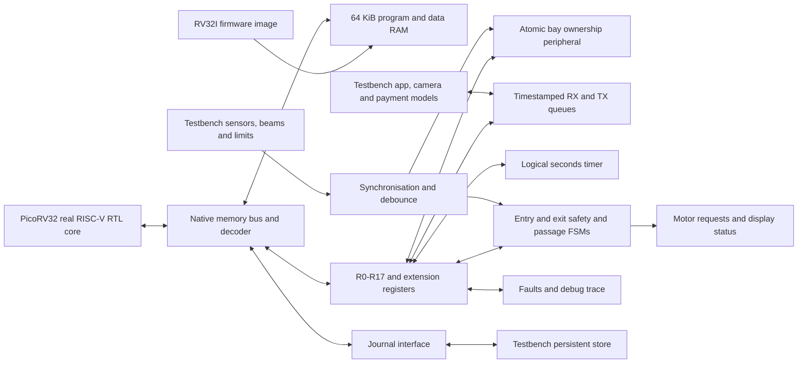

# ReservePark requirements and RISC-V simulation review

Reviewed: 24 October 2026, Malaysia. Baseline: v2.0 Flexible Parking Duration.

This is a review of the supplied requirements and planned implementation. No RTL, firmware, tests or waveform results existed in the workspace at review time. The commands below are planned commands, not executed results.

## 1. Source inventory and authority

| File | Reviewed content | Authority |
| --- | --- | --- |
| `Smart CarPark Challenge.pdf` | All 12 PDF pages, including rubric and submission instructions | Mandatory challenge requirements |
| `ReservePark_Flexible_Parking_Duration_Preview.pdf` | All 32 PDF pages, including R0-R17 appendix and exit guards | Current parking policy and presentation design |
| `RESERVEPARK_RISCV_Coding_Agent_Brief.md` | Full v2.0 implementation brief | Proposed RISC-V implementation, clarifications and verification scope |

Text was extracted from both PDFs; key architecture, register, FSM, DFx and submission pages were also rendered and visually inspected. The three original files were preserved. No PowerPoint, source repository, RTL, firmware, core checkout or existing simulation results were found. The historical PowerPoint mentioned in the brief is not supplied.

## 2. Mandatory challenge requirements

The official deliverable is a high-level architecture specification in PowerPoint. The challenge explicitly says no coding is required. A software-only RTL simulation is useful additional evidence; it does not replace any of the seven answers.

| Requirement | Marks | Current design coverage | Work needed for submission / POC |
| --- | ---: | --- | --- |
| 4.1 Block diagram, I/O and internal connections | 10 | Preview p7 | Make CPU, RAM and MMIO connections explicit; show per-block connections to the bus rather than relying on proximity |
| 4.2 IP blocks and functions | 10 | p8 | Split firmware policy, hardware safety and external models |
| 4.3 Interface signals and directions | 10 | p9 | Add clock/reset and concrete widths, ready/valid and per-lane feedback for implementation |
| 4.4.1 At least three NVM data items | 3 | p10 | Explain backing-store model and distinguish proposed persistence from tested recovery |
| 4.4.2 Register fields, widths, access, reset values | 7 | p11, p20-30 | Preserve R0-R17; finish extension fields and publication/acknowledgement semantics |
| 4.5 Exit FSM diagram and state descriptions | 15 | p12-13, p32 | Explicitly capture passage before close; map logical states to CPU and gate RTL |
| 4.6 At least four directed and three random conditions | 10 | p16 | Existing plan exceeds minimum; add actual test outcomes only after execution |
| 4.7 Two hardware issues, debug hooks, faster testing | 5 | p17 | Demonstrate sensor fault and consistency mismatch; distinguish proposed scan/BIST from implemented hooks |
| Innovation and corner cases | 20 | p3-6, p14-18, p31 | Explain immediate allocation, no-show handling and protected backup recovery |
| Presentation, timing, teamwork, Q&A | 10 | Requires team preparation | Rehearse 15-minute talk and 5-minute Q&A |

Foundations: at least one counter, two input units (camera and emergency/assistance button), two output units (barrier motor and kiosk display), register file, memory, and at least one advanced feature. The proposed design includes these. ACPR, motor controller and display controller may be treated as black boxes under the official challenge.

Submission checklist from official PDF p10:

- Deliver `Challenge_Group_<group_name>.pptx`; the supplied preview PDF does not fulfil this file-format requirement.
- Email subject: `[IUVB2026] Challenge Submission - <replace_with_group_number>`.
- To: `jin.chuan.see@intel.com`; `siti.nur.idayu.sabri@intel.com`. Cc: `chiah.hoong.quay@intel.com`.
- Submit before 1:00 pm on 25 October 2026, using the Malaysia event context. Late submission loses five marks.
- Include snapshots of externally produced illustrations with the slides or in an appendix.
- No email was sent during this review.

## 3. Policy baseline to preserve

1. Booking is immediate, against a currently vacant, healthy, unheld NORMAL bay. No future arrival slot, planned departure or interval calendar.
2. Successful local allocation commit defines confirmation T0. Failed payment authorisation or commit must not start a confirmed booking timer.
3. Arrival age 0 through 900 seconds is on time; greater than 900 and less than 2700 is late but eligible. At 2700 seconds, an unverified booking expires. The exact boundary convention is the brief's implementation clarification.
4. Entrance presence plus valid matching plate before the cutoff verifies arrival. Process captured timestamps, not the later firmware polling time.
5. Verified arrival enters ARRIVAL_PENDING and suppresses no-show charging even if the gate fails or no backup is available.
6. An unusable assigned bay triggers an atomic swap to a healthy, vacant, unheld protected backup before admission. No backup means assistance, not false admission.
7. A checked-in vehicle has no predetermined departure deadline. A 12-hour stay must remain valid.
8. Duration is actual exit passage time minus actual entry passage time. Billing happens through an external model; delayed ACK must not extend duration or block safe physical departure.
9. Replayed booking confirmation preserves the original booking, bay and T0. Billing retries preserve transaction identity.
10. Track physical bay occupancy, held reservations, vehicles inside, transit, ordinary availability and backup availability separately.

Use four bays (0-2 normal, 3 backup) and eight reservation records initially, as already proposed in the brief. The slide's 100-bay illustration is a capacity example, not a simulation result.

## 4. Planned SoC and simulation boundary



The processor executes compiled C and startup assembly. Firmware decides booking eligibility, plate matching, candidate bay, deadlines, recovery policy, billing IDs and session transitions. RTL captures events, verifies atomic ownership changes, handles bus/register semantics and enforces the motor interlock. The testbench supplies external events and checks observable outputs; it must not write the firmware reservation table to manufacture success.

The app, OCR, network, payment provider and mechanical barriers are behavioural environment models. No board, FPGA programming, physical sensor or real payment account is needed. Keep camera input and kiosk output represented as interfaces even if their payloads are plate tokens and display codes.

Preferred CPU configuration from the brief: RV32I, all 32 registers, no compressed instructions, no M extension, no interrupts initially. Pin an actual upstream revision and retain its licence. Startup sets stack, clears BSS, handles data placement and global-pointer conventions. Firmware uses `-march=rv32i -mabi=ilp32`; a Windows host compiler is not a substitute for a RISC-V cross compiler.

Memory map:

| Address region | Planned role |
| --- | --- |
| `0x00000000-0x0000FFFF` | 64 KiB firmware and data RAM |
| `0x10000000-0x10000FFF` | Parking MMIO |
| `0x20000000-0x20000FFF` | Journal interface |

R0-R17 use offsets `0x00-0x44` at four-byte spacing. R12 is 32-bit; other logical registers occupy the low 16 bits. Extensions begin at `0x48`, not the obsolete v1 offsets. RX and TX windows start at `0x80` and `0xC0`. A shared register specification should generate the C and Verilog constants.

## 5. Corrections and remaining implementation decisions

| Finding | Required resolution |
| --- | --- |
| Main controller is described as FSMs rather than a processor (p7-8) | Label RISC-V policy firmware and dedicated RTL gate FSMs separately; add instruction/data RAM |
| Internal bus is shown as a bar with incomplete explicit connectivity (p7) | Draw CPU-to-bus, bus-to-RAM and bus-to-peripheral links; distinguish data/control and external events |
| Cloud-confirmed booking/T0 wording (p4-5, p9) differs from local authoritative commit in the brief | Present request -> authorisation -> local atomic commit/T0 -> confirmation; remote retransmission cannot reset T0 |
| R7 passage fields are pulses (p24) | Convert CPU-visible indications to sticky/queued events and define explicit ACK; otherwise polling can lose crossings |
| R3 transit definition includes ambiguous checked-in status (p22) | Exclude verified drivers still outside; use entered-not-parked plus departed-bay-not-exited; keep ARRIVAL_PENDING separate |
| R15 AUTO_ASSIGN sounds like hardware chooses the bay (p29) | Document firmware candidate selection plus hardware commit/revalidation; preserve one authoritative ownership table |
| RO policy status requires a producer | Define staging and atomic publish for R2/R3/R8 and selected-record views; CPU must not silently write RO addresses |
| Exit commit follows successful close (p12-13, p32) | Capture passage/time/count once before close. Keep departure processing valid on closing failure; separate journal finalisation and bay release |
| EXIT_DONE mentions cloud informed (p32) | Queue notification; a disconnected cloud must not hold the gate FSM indefinitely |
| Sensor vacancy alone is insufficient for release | Require matching owner, confirmed departure and healthy vacant sensor. A car driving from bay to exit still owns its allocation |
| Debug language claims secured injection, scan and MBIST (p17, p27) | Mark these as proposed unless implemented. Maintenance mode alone is not authentication; a scratch RAM test is not full MBIST |
| NVM readiness is required before admission but persistence is staged later | For a core milestone explicitly identify a cold-start-only storage model. Do not claim warm-reset recovery until journal tests pass |

Before RTL implementation, finish mailbox word layouts and FIFO depths; event acceptance timestamp definition; plate/request/booking ID widths; allocation payload and ACK protocol; snapshot coherence; gate/debounce timeout values; sensor-valid/unknown handling; and journal record format. These are engineering details still open in the brief, not reasons to alter the parking policy.

Two especially important corner cases need explicit tests:

- No-show expiry must not race a pre-deadline arrival still queued for firmware. Service qualifying arrivals before expiry, with bounded queue progress and an explicit overflow uncertainty policy.
- Atomic reassignment must leave either the old or the new assignment valid, never allow two booking owners on the backup, and release only the matching old claim. A reset during this operation needs journal replay or an explicit manual-review outcome.

## 6. Environment assessment

Checked in the current Windows PowerShell environment:

| Tool | Observed state |
| --- | --- |
| Python | Available at `C:\Program Files\Python312\python.EXE`; PDF extraction/rendering succeeded |
| Git | Available at `C:\Program Files\Git\cmd\git.exe` |
| Icarus `iverilog`, `vvp` | Not found on current PATH |
| GTKWave | Not found on current PATH |
| RISC-V GCC, 32-bit or 64-bit prefix | Not found on current PATH |
| Clang | Not found on current PATH |
| Make | Not found on current PATH |
| WSL | Launcher exists, but reports Windows Subsystem for Linux is not installed |

PATH absence is not proof that no copy exists anywhere on disk. No dependencies were installed and no system configuration was changed. Choose a consistent native Windows toolchain or provision WSL; do not mix incompatible shell commands in the build scripts. A Python build/test runner will reduce Windows shell differences.

Upstream references checked during review:

- [PicoRV32](https://github.com/YosysHQ/picorv32): native-memory core variant and configurable ISA. The repository currently identifies itself as archived/read-only; an existing pinned revision can still support this POC. No revision has yet been acquired or verified locally.
- [Icarus getting started](https://steveicarus.github.io/iverilog/usage/getting_started.html): compile the design and execute it with VVP.
- [GTKWave documentation](https://gtkwave.github.io/gtkwave/): display recorded VCD/FST waveforms and save signal selections. GTKWave is the viewer, not the simulator.

## 7. Implementation sequence and acceptance gates

| Stage | Work | Evidence required before claiming completion |
| --- | --- | --- |
| 0 | Provision tools; pin core; define full register and transaction contracts | Tool versions, actual core SHA, source licence and reproducible build |
| 1 | Startup, RAM image, bus and CPU boot | Instruction fetch, firmware signature and heartbeat; CPU-reset negative control produces no bookings |
| 2 | Immediate booking, entry, parked state, exit, duration event | One complete CPU-mediated flow; independent counts and correct passage timestamps |
| 3 | 15/45-minute handling and protected backup | Boundary tests, single no-show fee, successful/failed recovery, backup protection and 12-hour stay |
| 4 | Faults, random tests, traces and evidence | Interlock checks, reproducible seeds, timeout failures, real waveforms and result manifest |
| 5 | Durable journal and reset recovery | Torn-write/replay tests, reset during reassignment, retained IDs and explicit ambiguity handling |

Stages are priorities, not permission to label unfinished work complete. The brief defines D00-D29 (30 directed scenarios); D19 and D27 require persistence. Report each as planned, passed, failed or skipped. A peripheral unit test does not count as a CPU-integrated scenario.

Three random families remain: traffic/allocation; latency/sensor disturbances; communication/restart. Suggested initial seeds from the brief are 1, 7, 42, 2026 and 9001. Restart cases remain unimplemented until stage 5 passes. Every run needs a bounded timeout, independent expected outcomes, nonzero exit on mismatch/trap, firmware hash and seed.

Essential invariants: no conflicting motor directions; no closing under qualified obstruction; one owner per bay; backups excluded from normal inventory; one count event per valid crossing; no no-show after verified check-in; no duration change due to billing delay; no silent allocation of unknown/occupied bays.

## 8. Icarus and GTKWave execution plan

Planned build chain:

```text
startup assembly + C + linker script
  -> RV32I ELF + map + disassembly
  -> little-endian binary -> 32-bit word hex
  -> $readmemh into simulated RAM
PicoRV32 + custom RTL + external models + scoreboard
  -> iverilog -> VVP executable
  -> vvp -> checks + event logs + VCD
  -> GTKWave -> saved signal views + presentation captures
```

The future build must reject missing/stale firmware and inspect the ELF/disassembly for unsupported instructions or unresolved runtime helpers. Honour native-bus byte strobes and held-request handshakes; a write side effect occurs once per accepted transaction.

These examples become runnable only after the named files are implemented:

```sh
make doctor
make firmware
iverilog -g2012 -s tb_reservepark -o build/reservepark.vvp -c rtl_files.f
vvp build/reservepark.vvp +SCENARIO=recovery +SEED=42
gtkwave build/recovery.vcd waves/recovery.gtkw
make test
make random SEED=42
make evidence
```

Use an explicit file list and top module, procedural checks with `$fatal`, and stable top-level debug wires. Avoid depending on unsupported classes/UVM/SVA. Drive testbench inputs away from active sampling edges and sample after nonblocking updates.

Logical time must retain real policy values 900/2700 seconds while accelerating the divider. Measure CPU service capacity, run at two acceleration factors and report both logical seconds and simulator time. For a 12-hour run, limit wave dumping to relevant transitions or use compact traces; do not dump every RAM word and every idle CPU cycle unnecessarily. A diagram or artificial ideal trace is not simulation evidence.

## 9. Waveform evidence checklist

| View | Signals/events | What it proves |
| --- | --- | --- |
| CPU proof | reset, trap, instruction fetch, valid/ready, address, write data/strobes, signature, heartbeat | Real firmware executes and reaches MMIO; correlate a store with disassembly |
| Normal entry/exit | request/plate, gate requests, limits, A/B beams, passage timestamps, bay occupancy, held/inside/bookable counts | Booking and motor movement do not themselves increment occupancy |
| No-show | T0, RTC seconds, grace/late flags, session state, release, fee type/ID | 900/2700 boundaries, one logical fee and no physical-count decrement |
| Backup recovery | original/current bay, occupancy/health, owner/commit response, notification and gate request | Backup lock is committed before entry permission |
| Fault | raw/qualified obstruction, close/open, timeout, sticky fault, ACK | Hardware interlock and visible fault handling |
| Flexible stay | check-in, entry/exit times, 12-hour elapsed interval, no-show flag, duration TX/ACK | No overstay policy; frozen actual duration and idempotent billing |

Each capture needs scenario ID, seed, core/firmware identity, source trace, expected observation and actual result. Use named state translations, decimal seconds/counts and hexadecimal IDs. Deliver VCD and `.gtkw` presets even if GUI capture is unavailable; do not claim presets were tested until actually opened or validated.

## 10. Review conclusion

The proposed four-bay PicoRV32 SoC is a suitable hardware-free POC for this architecture. The v2 brief already addresses most critical policy hazards and is substantially larger than the mandatory challenge. Prioritise the required PowerPoint and a working CPU-mediated flow, then add deadline/recovery evidence, with persistence explicitly tracked.

Current status: requirements reviewed; architecture and simulation plan assessed; source documents unchanged; no implementation or simulation pass claimed. The immediate implementation dependency is a working Icarus/VVP and RV32I compiler setup, followed by actual CPU boot. The immediate submission gap is the missing PowerPoint file.
