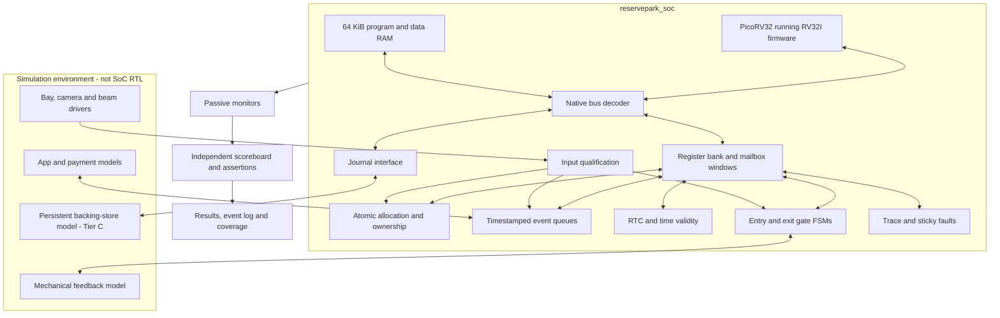
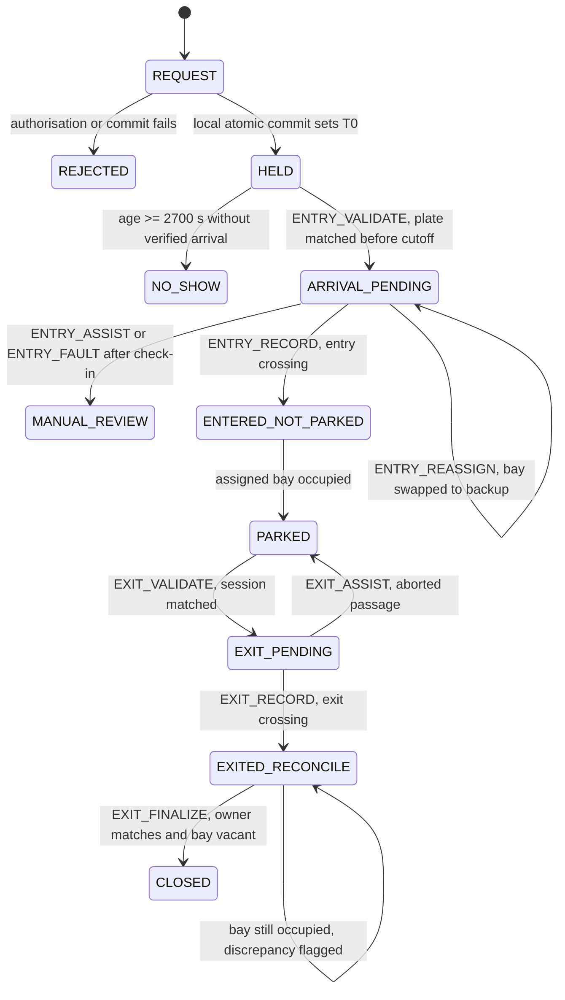
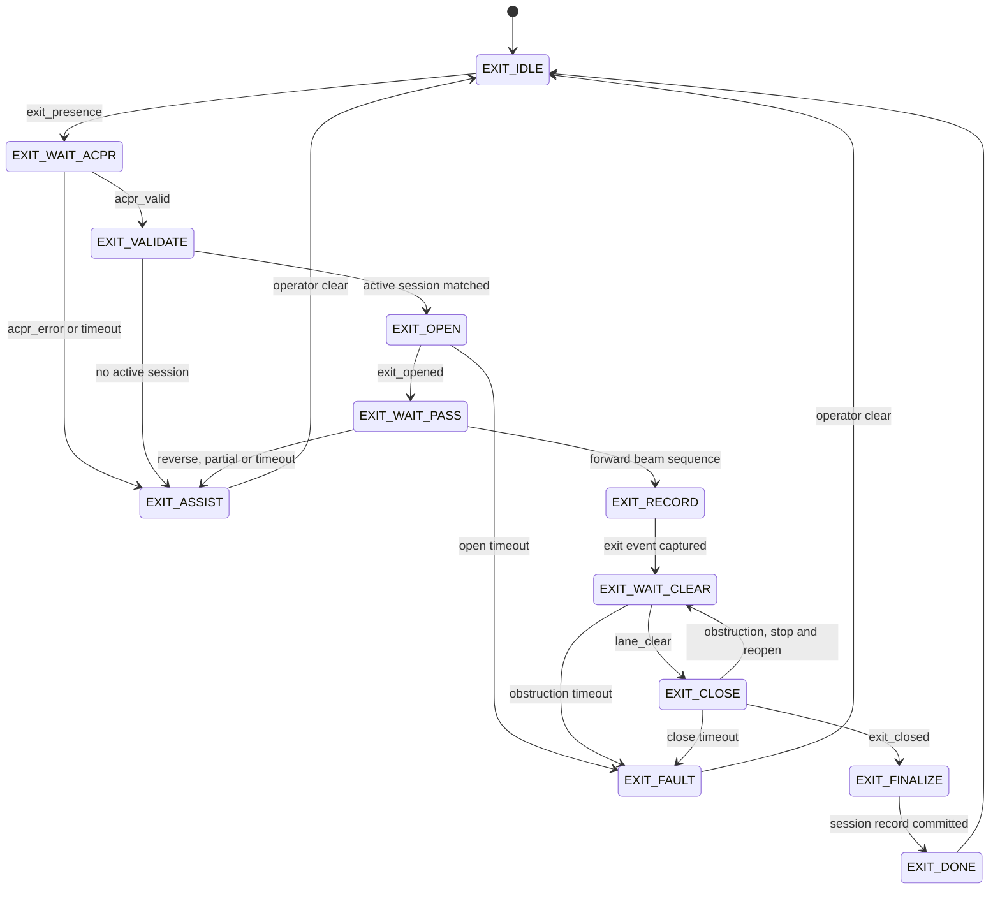

# RESERVEPARK: RISC-V SoC proof-of-concept and evidence PRD

Version: 1.1 | Date: 24 October 2026 (Malaysia) | Policy baseline: ReservePark v2.0 Flexible Parking Duration

Status: proposed implementation and showcase specification. This document contains requirements, planned tests and expected results. It contains no claim that RTL, firmware or simulations already exist or pass.

v1.1 changes: deadline priorities (section 0), a submission tier (section 4), the corrected exit FSM for challenge 4.5 (section 8.1), a long-run runtime budget (section 12), slide corrections and results-slide rules (sections 15.1-15.3), and a deadline risk.

## 0. Deadline priority

The graded deliverable is the PowerPoint, due before 1:00 pm on 25 October 2026. The challenge awards no marks for code. Simulation results go into the slides only as supporting evidence for the architecture answers.

Work in this order:

1. Slides answering 4.1-4.7 with the corrections in section 15.1. The deck must be submittable without any simulation result.
2. Tier A simulation: D00, D01, D07 and D21. This is the realistic target for results shown in the slides.
3. Showcase cases, in this order, each added only if it passes: D08 obstruction, D05 backup recovery, D03 no-show, D10 boundaries.
4. Everything else stays in the backlog with status PLANNED.

Time-box rules (proposed defaults; the team may move the times but should keep the rules):

- Toolchain cut-off: if Icarus/VVP and an RV32I compiler are not producing a CPU boot by 22:00 on 24 October, stop simulation work and present the planned test matrix only.
- Results freeze: stop running new cases at 10:00 on 25 October. Use the remaining time to insert evidence, rehearse and email the deck by 12:30.
- Slides may show only results from real runs, each labelled with run ID, scenario and seed. A case that did not run is shown as PLANNED, never as PASS.
- A Tier A-only result is presented as the "first integrated checkpoint", not as the full proof of concept.

## 1. Purpose and demonstration story

Build a hardware-free simulation of a reservation-only parking SoC that is small enough to understand, reproducible enough to defend, and instrumented enough to explain. A real RISC-V RTL core must execute firmware that controls custom parking peripherals. Icarus Verilog/VVP runs the simulation; GTKWave displays its recorded timing waveforms.

The audience should leave able to answer three questions:

1. What does our RTL do that software alone should not do? Capture crossings, retain events, enforce atomic bay ownership and inhibit unsafe barrier closing.
2. What does the processor contribute? Run booking, deadline, recovery and billing policy through actual instruction execution and memory-mapped I/O.
3. How do we know it works? A testbench drives external events, predicts outcomes independently, checks invariants and produces reproducible logs and waveforms.

Primary demonstration: a booking is assigned normal bay 0; that bay becomes unusable before arrival; firmware requests backup bay 3; RTL commits an exclusive swap; only then is entry permitted. A separate obstruction test shows that a software close request cannot defeat the hardware interlock.

The goal is clear engineering evidence, not maximum feature count. A small correct demonstration with visible limitations is more useful than many unverified feature claims.

## 2. Sources, decisions and scope authority

| Source | Authority |
| --- | --- |
| `../Smart CarPark Challenge.pdf` | Official deliverables, rubric and presentation requirements |
| `../ReservePark_Flexible_Parking_Duration_Preview.pdf` | Current parking policy and logical R0-R17 definitions |
| `../RESERVEPARK_RISCV_Coding_Agent_Brief.md` | Existing implementation baseline, D00-D29 scenarios and technical clarifications |
| `requirements_and_simulation_review.md` | Cross-check, environment observations and identified slide corrections |
| This PRD | Proposed delivery priorities, testbench structure and evidence/showcase contract |

The four-bay system, PicoRV32/RV32I, Icarus and GTKWave come from the existing brief. Testbench task names, output layout, queue sizes and showcase ordering below are proposed engineering defaults, not prior user decisions. A builder may tune resource sizes and timeouts after measurement, recording the change in the run manifest. Policy semantics and pass criteria must not be weakened to obtain a pass.

This is a document-writing deliverable, not authorization to report hypothetical simulations as completed. The full baseline remains tracked even when an early milestone implements only part of it.

## 3. Audience, mandatory submission and success criteria

Audience: bootcamp judges, teammates and engineers reviewing introductory SoC architecture and verification. Assume familiarity with clocks, registers and FSMs but explain reservation-policy details.

The official challenge requires PowerPoint answers to 4.1-4.7; coding is optional. Preserve the required 15-minute presentation and 5-minute Q&A. Submit `Challenge_Group_<group_name>.pptx` before 1 pm on 25 October 2026 in the Malaysia event context. The PowerPoint is not currently present. Simulation evidence complements the architecture answers and does not replace them.

Success criteria:

- A clean build executes the same firmware image across all normal scenario tests.
- A CPU boot signature, instruction fetch and policy-related MMIO transaction are visible.
- A CPU-held-reset negative control produces no policy-driven booking acceptance.
- Core showcase tests have explicit expected outcomes and independent checks.
- Each displayed result links to a real run, source revision, firmware hash and trace/log.
- The team can explain one RTL module, one firmware decision, one driver task and one scoreboard check using a short source excerpt and waveform.
- The test report distinguishes planned, passed, failed, skipped and blocked work.
- The presentation still answers all seven challenge sections when a demo cannot run live.

## 4. Delivery tiers and priorities

| Tier | Scope | Completion meaning |
| --- | --- | --- |
| 0: submission | Slides for 4.1-4.7 with section 15.1 corrections and the planned test matrix | Required for 25 October. Independent of every simulation tier |
| A: first integrated checkpoint | Real CPU boot; immediate booking; normal entry, parking and exit; actual-duration event | Demonstrates integration only. Must not be presented as the full POC |
| B: core showcase release | Tier A plus no-show, exact boundaries, backup success/failure, obstruction, long stay, duplicate messages, three random families without persistence cases | Minimum intended showcase release under this PRD |
| C: full recovery extension | Durable journal, interrupted writes, warm reset/replay and reset during backup swap | Required before claiming reset/crash recovery |

For the 25 October submission the target is Tier A plus whichever section 0 showcase cases pass. Tier B is a post-submission goal unless it finishes early.

Tier B includes peripheral bus tests and an independent scoreboard. Tier C remains part of the baseline backlog; mark its scenarios skipped with a reason in a Tier B report. Do not silently remove them from the coverage denominator.

Out of scope: physical FPGA/ASIC, synthesis or timing closure claims, custom CPU design, raw image processing, real network stacks, mobile application, real money, full vehicle dynamics, formal proof, production scan/ATPG, security certification and physical power-loss guarantees.

## 5. Functional requirements

| ID | Requirement | Observable acceptance |
| --- | --- | --- |
| F01 | Commit an immediate booking only to a healthy, known-vacant, unheld normal bay | One accepted booking/owner and unchanged physical occupancy |
| F02 | Define T0 at successful local commit; reject failed authorisation/commit | No confirmation or started countdown after failure |
| F03 | Preserve result for identical request replay; reject reused ID with changed content | Same ID/bay/T0 on replay; explicit conflict otherwise |
| F04 | Permit one active booking/session per plate token | New request for same active plate is rejected |
| F05 | Apply on-time age <=900 s, late 900<age<2700 s, expiry at age>=2700 s if unverified | Boundary tests at 899/900/901 and 2699/2700/2701 |
| F06 | Verify arrival using entrance presence plus matching plate captured before deadline | ARRIVAL_PENDING suppresses no-show even if subsequent admission fails |
| F07 | Revalidate bay before admission; atomically swap to a compatible backup if required | Backup assignment committed before open request |
| F08 | Keep backup bay unavailable to ordinary booking | Full normal inventory rejects requests even with backup free |
| F09 | Count only confirmed directional passage and qualified physical occupancy | Booking/opening never masquerades as physical movement |
| F10 | Prevent close under qualified obstruction, independently of firmware | Close output is zero whenever qualified obstruction is asserted |
| F11 | Capture entry and exit once; bill actual duration after departure | Delay/duplicate ACK cannot change duration or create another logical charge |
| F12 | Allow unrestricted stay after check-in | A 43,200-second entry-to-exit test has no no-show/overstay event |
| F13 | Preserve physical departure if later closing fails | Inside count and exit time remain committed; mechanical fault is separate |
| F14 | Keep an exited but sensor-occupied bay unavailable | Fault/reconciliation state visible; no new owner assigned |
| F15 | Expose assistance, display status, sticky faults and trace | Assistance event is visible without automatically opening the gate |
| F16 | Gate policy on readiness; handle lost events explicitly | Invalid time suppresses expiry; overflow raises fault and suspends uncertain penalties |
| F17 | Queue/retry external notifications and fees during network failure | Same transaction ID on retry; physical departure is not blocked by ACK |
| F18 | Recover only complete valid journal records in Tier C | Torn write ignored or ambiguity flagged; no double owner/charge |

The definitions above take precedence over illustrative graphs. All times are logical seconds, not wall-clock demo duration.

## 6. Architecture and ownership



| Component | Owns | Must not own |
| --- | --- | --- |
| Firmware | Booking records, policy, candidate selection, deadline decisions, transaction IDs, retries | Direct motor interlock bypass or test-dependent expected answers |
| Allocator RTL | One ownership table, current sensor/health validation, all-or-nothing commit/swap | Autonomous parking policy with CPU stopped |
| Gate RTL | Feedback sequencing, directional crossing detection, obstruction inhibition, timestamps | Deciding whether a plate is authorised |
| Testbench | External stimuli, realistic feedback, independent expected state and failure detection | Forcing internal FSM states or editing the firmware table in integrated tests |
| Evidence scripts | Transforming actual logs/traces into figures and tables | Inventing missing measurements or replacing failed results |

Use separate entry and exit gate instances. Poll retained events initially; do not add interrupt complexity simply to populate the block diagram.

## 7. Implementation-facing contracts

### 7.1 CPU, memory and register rules

Use upstream PicoRV32 native `mem_valid/mem_ready` interface with RV32I/ILP32 firmware. Enable all integer registers; initially disable compressed instructions, multiplication/division and IRQ execution. Pin the real core SHA and preserve its licence. Any unsupported instruction/trap fails an ordinary test.

RAM: `0x00000000-0x0000FFFF`; MMIO: `0x10000000-0x10000FFF`; journal: `0x20000000-0x20000FFF`. Reset entry is address zero. Startup must establish stack, initialise data/BSS and fit image/data/stack within RAM. Produce ELF, map, disassembly, binary and deterministic little-endian word hex.

R0-R17 retain the brief's offsets `0x00-0x44`. Extensions start at `0x48`; never reuse R13-R17 addresses. RO ignores writes, WO reads zero, unused bits read zero, byte strobes are honoured. W1C set wins over clear on the same cycle. A held native-bus request must not repeat a side effect. Unmapped data access completes with documented benign data and a sticky bus fault. Instruction fetches must not trigger MMIO actions.

Create `spec/registers.json` before RTL coding to record offsets, fields, access, reset values and side effects. Generate C and Verilog constants from it. Policy-owned RO status uses explicit staging/publication; a publication sequence number allows a reader to detect a mixed snapshot. Publish related count fields as one coherent snapshot.

### 7.2 Proposed small configuration

| Parameter | Initial default / rule |
| --- | --- |
| Bays | 4; normal 0-2, protected backup 3 |
| Reservation records | 8; distinguish table capacity from parking capacity |
| IDs | 32-bit plate token, request ID, booking ID and transaction ID; no real plate data |
| RX/TX queues | 16 entries each initially; record actual depth in manifest |
| Clock | One clock; proposed 10 ns period is a simulation setting, not a proven achievable clock frequency |
| Sensor qualification | Two synchroniser stages plus parameterised stable-sample filter; initial filter 3 samples |
| Trace | Bounded 256-event buffer initially; explicit wrap/overflow indicator |
| Logical seconds | Parameterised cycles per second, calibrated after CPU boot |
| Motor timeouts | Parameterised cycle counts, comfortably above qualified model response; values logged per run |
| Compatibility | All four bays compatible in first POC; do not claim vehicle-class matching |

Resource defaults may change for runtime or workload reasons. Queue overflow and saturation still require directed tests; increasing a queue must not conceal missing handling.

### 7.3 Event and transaction semantics

Each accepted event has event ID, type, plate token, booking ID where applicable, bay ID, capture timestamp and payload/flags. Ready/valid payload is stable until accepted; FIFO head is stable until explicit pop. Assign the timestamp at a documented capture point before software polling. Preserve a captured timestamp through queue/backpressure delays. If capture storage fills, raise an explicit evidence-loss fault rather than silently discarding arrival evidence.

The builder chooses exact word layouts within the existing mailbox windows and records them in the register specification before coding. Use separate channels or enough scheduling fairness that TX backpressure cannot prevent safety handling. On uncertain arrival loss, suspend automatic penalties for potentially affected records until reconciliation; a conservative all-unarrived-record suspension is acceptable for this four-bay POC if disclosed and tested.

Allocator requests carry booking identity, expected current owner/bay, proposed bay, command and transaction ID. A rejection leaves ownership unchanged. A successful swap publishes one new assignment and releases only the matching old claim. Sensor/health revalidation happens at commit, not only at firmware candidate selection.

Normal release needs confirmed exit, matching owner and qualified vacancy/health. No-show release removes the booking hold but never clears a physical occupancy sensor. Recovery release of an unusable original bay leaves that bay physically unavailable when occupied/faulted.

### 7.4 Count definitions

| Quantity | Definition |
| --- | --- |
| PHYS_OCC | Population count of qualified occupied bay sensors |
| HELD_NOT_ARRIVED | Confirmed bookings with no verified arrival and a live hold |
| ARRIVAL_PENDING | Verified arrivals awaiting successful physical entry or assistance |
| INSIDE_COUNT | Once-counted confirmed entries minus confirmed exits |
| IN_TRANSIT | Entered-not-parked plus departed-bay-not-exited sessions |
| BOOKABLE_NOW | Known vacant, healthy, unheld NORMAL bays |
| BACKUP_FREE | Known vacant, healthy, unheld protected bays |

Do not require PHYS_OCC == INSIDE_COUNT during transit or under deliberately injected unauthorised occupancy. Compare with session/transit context and flag discrepancies; never repair a mismatch merely by copying one counter into another.

## 8. State-machine design and explanation

Three state machines, aligned by name. The overall booking FSM below runs once per booking in firmware. The entry lane FSM (section 8.2) and exit lane FSM (section 8.1) run once per vehicle at each gate. Only five lane states move a booking: ENTRY_VALIDATE, ENTRY_RECORD, EXIT_VALIDATE, EXIT_RECORD and EXIT_FINALIZE. Slide images: `docs/diagrams/overall_fsm.png`, `entry_fsm.png`, `exit_fsm_4_5.png`.



| Booking state | Lane states running during it |
| --- | --- |
| ARRIVAL_PENDING | ENTRY_PREFLIGHT, ENTRY_REASSIGN, ENTRY_OPEN, ENTRY_WAIT_PASS |
| ENTERED_NOT_PARKED | ENTRY_WAIT_CLEAR, ENTRY_CLOSE, ENTRY_DONE, then driving to the bay |
| EXIT_PENDING | EXIT_OPEN, EXIT_WAIT_PASS |
| EXITED_RECONCILE | EXIT_WAIT_CLEAR, EXIT_CLOSE, EXIT_FINALIZE, EXIT_DONE |

This is a policy diagram, not evidence of executed transitions. Unexpected movement, timeouts and faults must have explicit handlers; the diagram shows only principal transitions.

Gate sequence: IDLE -> OPENING -> WAIT_PASSAGE -> WAIT_CLEAR -> CLOSING -> DONE, with FAULT handling. Require qualified feedback; reset alone is not evidence that a barrier is closed. Recognise the configured forward beam sequence `00 -> 10 -> 11 -> 01 -> 00`; reverse/partial/noisy sequences must not produce an ordinary committed crossing. Rearm only after clear and a new authorisation. For this prototype use the overlap sequence only and state this physical-model assumption.

On obstruction during closing, inhibit close and request reopening; restart closing only after qualified clearance. Never assert open and close together. Measure inhibition relative to the qualified obstruction signal, while also showing raw-input-to-qualified latency. Do not describe synchroniser/filter delay as instantaneous physical protection.

Capture physical exit and its timestamp at accepted crossing. Successful barrier closure, journal completion, bay release and billing ACK are separate facts. The presentation's EXIT_COMMIT state must not erase a real departure when later gate closure fails.

### 8.1 Corrected exit FSM for challenge 4.5

This replaces the exit FSM on preview slides 12, 13 and 32 in the submitted deck. Firmware owns validation and session records. Gate RTL owns motor sequencing, beam decoding, exit timestamp capture and the obstruction interlock.



| State | Action | Guard and next state |
| --- | --- | --- |
| EXIT_IDLE | Barrier closed; wait for a vehicle at the exit | exit_presence=1 -> EXIT_WAIT_ACPR |
| EXIT_WAIT_ACPR | Trigger plate recognition | acpr_valid -> EXIT_VALIDATE; acpr_error or timeout -> EXIT_ASSIST |
| EXIT_VALIDATE | Firmware matches the plate token to an active session that is PARKED or has left its bay | match -> EXIT_OPEN; no match -> EXIT_ASSIST |
| EXIT_OPEN | Request open; wait for limit feedback | exit_opened -> EXIT_WAIT_PASS; open timeout -> EXIT_FAULT |
| EXIT_WAIT_PASS | Decode beams for the forward sequence `00 -> 10 -> 11 -> 01 -> 00` | complete sequence -> EXIT_RECORD; reverse, partial or timeout -> EXIT_ASSIST with no movement counted |
| EXIT_RECORD | RTL captures the exit timestamp at the crossing. INSIDE_COUNT decrements once. Firmware queues PARKING_DURATION | exit event accepted -> EXIT_WAIT_CLEAR |
| EXIT_WAIT_CLEAR | Hold open while the lane is obstructed. Do not wait for bay vacancy | lane_clear -> EXIT_CLOSE; obstruction timeout -> EXIT_FAULT with barrier left open |
| EXIT_CLOSE | Request close. The hardware interlock blocks close under qualified obstruction | exit_closed -> EXIT_FINALIZE; obstruction -> stop, reopen, EXIT_WAIT_CLEAR; close timeout -> EXIT_FAULT |
| EXIT_FINALIZE | Journal session close. Release the bay only with matching owner, confirmed departure and healthy vacant sensor; otherwise flag a discrepancy and keep the bay unavailable | record committed -> EXIT_DONE |
| EXIT_DONE | Queue the cloud and app notification. Do not wait for its acknowledgement | -> EXIT_IDLE |
| EXIT_ASSIST | Unmatched plate, ACPR failure or aborted passage. Show kiosk instruction and call an operator. Any close uses the same interlocked close path | operator clear -> EXIT_IDLE |
| EXIT_FAULT | Motor or obstruction timeout. Raise the R9 cause and alarm. An exit already recorded in EXIT_RECORD is never undone | operator clear -> EXIT_IDLE |

Differences from the preview slides, to state in the talk:

1. EXIT_RECORD is new. The exit time is captured at the crossing, not after the barrier closes, so a closing failure cannot lose or lengthen the stay.
2. EXIT_COMMIT becomes EXIT_FINALIZE. It finalises the session and bay release only.
3. Obstruction during closing stops and reopens the barrier. Only a timeout is a fault.
4. EXIT_DONE queues the cloud notification instead of waiting for it.
5. The beam check is the full four-step overlap sequence, not "A then B".

The exit FSM uses the same column grid as the entry FSM in section 8.2. Column 3 is empty on exit because a leaving car needs no bay check.

### 8.2 Entry FSM

Optional extra slide; the challenge provides an entry FSM template and requires only the exit FSM. This version extends the template for a reservation-only car park and mirrors the exit FSM state for state.

| State | Action | Guard and next state |
| --- | --- | --- |
| ENTRY_IDLE | Barrier closed; wait for a vehicle at the entrance | entry_presence=1 -> ENTRY_WAIT_ACPR |
| ENTRY_WAIT_ACPR | Trigger plate recognition | acpr_valid -> ENTRY_VALIDATE; acpr_error or timeout -> ENTRY_ASSIST |
| ENTRY_VALIDATE | Firmware matches the plate token to a HELD booking captured before the cutoff. Sets ARRIVAL_PENDING and stops the no-show timer | match -> ENTRY_PREFLIGHT; no valid booking or past cutoff -> ENTRY_ASSIST, barrier stays closed |
| ENTRY_PREFLIGHT | Check the assigned bay is still vacant and healthy | ok -> ENTRY_OPEN; occupied, faulty or unknown -> ENTRY_REASSIGN |
| ENTRY_REASSIGN | Firmware picks the lowest free healthy backup; allocator RTL commits the swap atomically before any open request | committed -> ENTRY_OPEN; no backup free -> ENTRY_ASSIST |
| ENTRY_OPEN | Request open; wait for limit feedback | entry_opened -> ENTRY_WAIT_PASS; open timeout -> ENTRY_FAULT |
| ENTRY_WAIT_PASS | Decode beams for `00 -> 10 -> 11 -> 01 -> 00` | complete sequence -> ENTRY_RECORD; reverse, partial or timeout -> ENTRY_ASSIST with no movement counted |
| ENTRY_RECORD | RTL captures the entry timestamp at the crossing. INSIDE_COUNT increments once. Booking moves to ENTERED_NOT_PARKED | event captured -> ENTRY_WAIT_CLEAR |
| ENTRY_WAIT_CLEAR | Hold open while the lane is obstructed | lane_clear -> ENTRY_CLOSE; obstruction timeout -> ENTRY_FAULT with barrier left open |
| ENTRY_CLOSE | Request close. Hardware interlock blocks close under qualified obstruction | entry_closed -> ENTRY_DONE; obstruction -> stop, reopen, ENTRY_WAIT_CLEAR; close timeout -> ENTRY_FAULT |
| ENTRY_DONE | Show the assigned bay on the kiosk; queue app notification | -> ENTRY_IDLE |
| ENTRY_ASSIST | Unreadable plate, no valid booking, no backup or aborted passage. Kiosk instruction and operator call. A verified arrival goes to MANUAL_REVIEW, never NO_SHOW | operator clear -> ENTRY_IDLE |
| ENTRY_FAULT | Motor or obstruction timeout. Raise the R9 cause and alarm. A recorded entry is never undone | operator clear -> ENTRY_IDLE |

Mapping to the challenge template: ENTRY_CHECK_SPACE becomes ENTRY_PREFLIGHT, because every arriving car already owns a bay. ENTRY_STORE_INFO splits into check-in at ENTRY_VALIDATE and entry time at ENTRY_RECORD. ENTRY_WAIT_LANE_CLEAR splits into ENTRY_WAIT_PASS and ENTRY_WAIT_CLEAR. The template's "decrement one available space" at close already happened at booking commit, so ENTRY_CLOSE only closes. Preview page 14's BAY_PREFLIGHT and REASSIGN_LOCK are renamed ENTRY_PREFLIGHT and ENTRY_REASSIGN.

## 9. Testbench design

### 9.1 Verification layers

| Layer | DUT | Purpose |
| --- | --- | --- |
| Unit | FIFO, timer, sensor filter, gate FSM, allocation peripheral, bus/register bank | Isolate local corner cases and speed debug |
| Integration | CPU + image + RAM + bus + MMIO | Prove boot, firmware execution and native-bus contract |
| System | Complete SoC + environment models | Prove processor-mediated parking behaviours |

Label every result with its layer. A bus-master unit test may drive MMIO directly. An integrated parking scenario must use external app/camera/sensor interfaces, not a testbench pretending to be the processor.

### 9.2 Testbench components

Proposed files: `tb_reservepark.sv`, `drivers.sv`, `environment_models.sv`, `monitors.sv`, `scoreboard.sv`, `checks.sv`, `scenarios.sv`. Separate files only where useful; avoid a class/UVM framework for this scale.

- Clock/reset driver: deterministic reset and bounded readiness wait.
- App driver: submit stable request payload; wait ready; record acceptance; support replay/conflict.
- Camera driver: issue valid/error plate results with presence and capture timing.
- Sensor driver: produce qualified-length bay/beam levels, short glitches and explicit fault cases.
- Barrier model: turn motor requests into delayed opened/closed feedback; inject missing feedback and obstruction.
- Provider model: accept fee ID, deduplicate, delay/drop/duplicate ACK; record attempts separately from unique transactions.
- Passive monitors: observe accepted handshakes, motor outputs, qualified passage, published status and external responses.
- Scoreboard: maintain independent booking/session/ownership/time expectations from stimulus and observed transactions.
- Check library: failure message includes scenario, cycle, logical time, expected, observed and event context; call `$fatal`.
- Runner: compile, execute, enforce wall-time timeout, collect exit code and parse results.

Suggested driver tasks: `submit_booking`, `present_plate`, `set_bay_state`, `drive_forward_passage`, `drive_reverse_passage`, `set_obstruction`, `set_network`, `ack_payment`, `wait_for_response`, `wait_until_logical_time`. Every waiting task has a bound. Drive synchronous stimulus on falling edges and sample after rising-edge nonblocking updates.

### 9.3 Independent oracle

The scoreboard knows which external requests were accepted and which sensor patterns it drove. It computes expected eligibility and state from those facts. It may inspect DUT outputs to compare them, but must not read DUT counts/ownership as the source of expected values.

Match responses by IDs rather than assuming fixed firmware latency. In deterministic single-request tests, lowest eligible bay is the expected allocation. In concurrent-request tests, either accepted ordering is valid if each response has a unique eligible bay and a consistent T0. Record ordering instead of forcing one arbitrary arbitration result.

Use separate checks for stimulus validity and DUT correctness. An unrealistic sensor sequence is an intentional fault test, not ordinary traffic. Unit tests can inspect internal debug signals; system acceptance should primarily depend on public interfaces and documented debug snapshots.

### 9.4 Scoreboard example: expected normal lifecycle

The following is an expectation table, not measured output. Initial sensors are known vacant; all bays healthy; time/storage readiness valid.

| Event | PHYS_OCC | INSIDE | HELD | BOOKABLE | BACKUP_FREE |
| --- | ---: | ---: | ---: | ---: | ---: |
| Initial | 0 | 0 | 0 | 3 | 1 |
| Booking committed to bay 0 | 0 | 0 | 1 | 2 | 1 |
| Verified arrival, before passage | 0 | 0 | 0 | 2 | 1 |
| Entry crossing | 0 | 1 | 0 | 2 | 1 |
| Bay 0 occupied | 1 | 1 | 0 | 2 | 1 |
| Bay 0 vacant while car approaches exit | 0 | 1 | 0 | 2 | 1 |
| Exit crossing and safe session release completed | 0 | 0 | 0 | 3 | 1 |

Allow bounded publication latency between a physical event and firmware status snapshot. INSIDE and PHYS_OCC remain distinct throughout. The arrival-pending and transit checks explain the intermediate rows.

## 10. Directed test catalogue and release mapping

Preserve the original D IDs for traceability. All entries initially have status PLANNED.

| ID | Scenario and principal check | Tier |
| --- | --- | --- |
| D00 | CPU boot/signature, fetch/MMIO evidence and reset negative control | A |
| D01 | +12-minute arrival accepted, passage and distinct counts correct | A |
| D02 | +30-minute arrival late but accepted without no-show fee | B |
| D03 | No arrival at +45: one fee ID, hold released, physical count unchanged | B |
| D04 | Wrong plate or expired booking cannot normally open entry | B |
| D05 | Original bay becomes occupied after booking; backup committed before entry | B |
| D06 | Backup unavailable: assistance, no admission, no fee for verified arrival | B |
| D07 | Normal exit: one movement, correct timestamps and release | A |
| D08 | Obstruction during close inhibits output and requests reopening | B |
| D09 | Verified +44-minute arrival then gate fault never becomes no-show | B |
| D10 | Boundary sweep at 899/900/901 and 2699/2700/2701 seconds | B |
| D11 | Duplicate booking, ACK and sensor stimuli do not duplicate side effects | B |
| D12 | Concurrent booking/recovery preserves one owner per bay | B |
| D13 | Reverse/partial crossing creates no normal passage/count change | B |
| D14 | Bay remains occupied after exit: inside decrements, bay remains unavailable | B |
| D15 | Concurrent entry/exit: both captured, net count correct | B |
| D16 | Byte strobes, RO/WO/W1C, held request, invalid address and delayed response | B; unit/integration |
| D17 | Network outage: cached booking policy, new remote booking suspension, queued fees | B |
| D18 | Invalid readiness/time and overflow: explicit faults, conservative action | B |
| D19 | Reset/torn journal or fee commit: replay or explicit ambiguity | C |
| D20 | Closing failure after exit cannot undo movement or extend duration | B |
| D21 | Immediate booking with no future schedule fields and commit-defined T0 | A |
| D22 | Normal and recovered sessions stay 12 hours without overstay cancellation | B |
| D23 | Normal capacity exhausted while backup free: reject ordinary request | B |
| D24 | Repeated confirmation returns original ID, bay and T0 | B |
| D25 | Delayed/duplicate billing ACK: fixed duration, one unique transaction | B |
| D26 | Authorisation/commit failure leaves no confirmed booking or provisional leak | B |
| D27 | Reset during backup swap: one recovered assignment or review | C |
| D28 | Released normal/backup bay restores correct inventory category | B |
| D29 | Sensor eligibility changes before commit: reject stale candidate | B |

Tier A does not exhaust the acceptance checks of these IDs until every stated subcase is executed. Record subcases explicitly, particularly D00 negative control, D10 boundaries, D22 normal/backup variants and D16 bus semantics.

### Detailed showcase recipes

**S1 / D05 recovery:** initialise clean state; book token A to normal bay 0; wait committed confirmation; make bay 0 occupied; present matching arrival at age 720 s; expect backup 3 commit and original/current snapshot 0/3 before gate-open request; drive forward crossing; occupy bay 3. Check normal inventory excludes occupied bay 0, backup-free becomes zero, exactly one legitimate owner remains for A, and unauthorised original occupancy is flagged. Do not pretend the injected occupant is a second legitimate booking.

**S2 / D03 no-show:** book at known T0; supply no qualifying arrival; observe one late reminder after 900 s; at 2700 s expect release and one unique NO_SHOW_FEE ID; drop first ACK; permit retry; duplicate the eventual ACK. Check attempt count may exceed one but unique fee count is one, PHYS_OCC and INSIDE remain zero, and ordinary availability returns to three.

**S3 / D08 safety:** admit an authorised session, complete passage, begin close with clear lane; assert raw obstruction and hold long enough to qualify; compare raw/qualified signals, motor output and FSM transition. Check no close while qualified obstruction, no contradictory directions, fault/trace recorded as specified, and no second movement counted during reopening.

**S4 / D22+D25 flexible stay:** enter and park; keep the session valid for 43,200 logical seconds between actual passage timestamps; vacate bay and exit; delay billing ACK and duplicate it. Check no no-show/overstay event, duration exactly 43,200 s for this fixture, one unique duration transaction and safe release independent of ACK. Repeat using recovered backup ownership.

## 11. Random testing and coverage

Use deterministic recorded seeds 1, 7, 42, 2026 and 9001. Initial workload default: 100 accepted external transactions per seed, with minimum event-type quotas and bounded model responses. Record generated and accepted counts separately. Tune runtime after measuring; do not generate a random test that can pass without exercising its intended conditions.

| Family | Stimulus | Independent checks |
| --- | --- | --- |
| R1 traffic/allocation | Multiple plate requests, normal capacity exhaustion, arrivals, variable stays, concurrent lane activity | Unique ownership, backup protection, counts, valid lifecycle |
| R2 timing/sensors | Camera delay/error, sensor glitches, bay blockage, backup faults, obstruction, feedback timeout | Safe outputs, no stale allocation, no duplicate passage |
| R3 communication | Dropped/duplicate requests and ACKs, outages, arrivals near cutoff | Stable IDs/T0, no unfair fee, bounded recovery/progress |
| R3 restart extension | Warm reset and interrupted storage writes | Tier C only: journal replay and persistent idempotency |

All random tests check common invariants on every applicable sampled cycle. Report scenario coverage (passed required scenarios / required scenarios), directed subcase coverage, declared FSM transition coverage, and random scenario-bin hits. Give numerator, denominator and excluded/pending bins. This is functional coverage, not commercial RTL code coverage or proof of completeness.

Prove the checker can fail: during development use a clearly labelled checker self-test with an intentionally wrong expected value or mutated test fixture, verify nonzero runner exit, then exclude it from normal DUT pass totals. Never modify the DUT to generate a polished passing screenshot.

## 12. Timing and performance measurement

Use three time notions: simulator time in ns, clock cycles and logical RTC seconds. Graph axes and captions must say which is used. A 10 ns simulation clock is not a timing-closure measurement.

After CPU boot, measure the maximum observed event-service cycles for the declared workload, then choose cycles-per-logical-second with margin. Record the largest queue depth and service latency. Run boundary/recovery tests at the chosen divider and a slower logical-time setting (for example twice the cycles per second). Both must preserve policy outcomes.

Do not run a 12-hour stay by reducing the 2700-second policy threshold. Ordinary tests keep monotonic time. If an externally permitted idle time synchronisation is used for boundary setup, identify it and keep it separate from elapsed-time validation. For long runs, dump selected summary signals and narrow transition windows rather than the complete core and RAM continuously. Report actual wall-clock runtime after measurement; no runtime target is a measured result yet.

Runtime budget for long runs: after CPU boot, measure simulated cycles per wall-clock second on the presentation machine. Estimate the D22 runtime as 43,200 x cycles-per-logical-second / measured cycles-per-second. Disable full VCD dumping during the idle stay. If the estimate exceeds the time left before the results freeze, mark D22 BLOCKED (runtime) and show D03 or D05 instead. Never shorten the policy thresholds to make it fit.

## 13. Evidence package and figure specifications

Use a small fixed set of figures; each should answer one engineering question. Architecture/FSM diagrams are design explanations. Waveforms and plots become results only when generated from a verified run.

| Asset | Question answered | Source and required content | Main talk? |
| --- | --- | --- | --- |
| E01 SoC diagram | Where are hardware, firmware and environment boundaries? | Diagram in section 6 refined with named interfaces and widths | Yes |
| E02 Testbench diagram | Who drives and who checks? | Driver -> DUT -> monitor -> scoreboard, plus independent expected model | Yes |
| E03 CPU waveform | Is a real processor making decisions? | Fetch, mem_valid/ready, address/wdata/strobes, signature, heartbeat, correlated firmware store | Briefly |
| E04 Recovery waveform | Does the backup lock precede entry? | Original/current bay, occupancy/health, alloc request/response, owner, gate-open | Yes |
| E05 Safety waveform | Can hardware override an unsafe request? | Raw/qualified obstruction, close request, open/close outputs, gate state, fault | Yes |
| E06 Policy timeline | Are deadlines and long stays handled correctly? | Trace-derived age/state/fee events; separate no-show and long-stay panels | Yes |
| E07 Count step plot | Why are occupied, held and inside different? | Event-derived PHYS_OCC, INSIDE, HELD and BOOKABLE; annotate passage/bay transitions | Appendix or replace a dense waveform |
| E08 Test matrix | What was actually tested? | Results JSON -> scenario/seed/layer/status table with pending rows | Yes |
| E09 Measured latency plot | How quickly did firmware handle events in this simulation? | Acceptance-to-decision cycles from monitors; sample count/configuration | Optional appendix |
| E10 Journal recovery trace | What survives reset? | Real Tier C before/reset/replay events and ownership/fee IDs | Only if passed |

Prefer an event/state timeline and count step plot over decorative dashboards. Avoid pie charts for pass rates, graphs with invented values and screenshots containing hundreds of unreadable signals.

### 13.1 GTKWave presentation rules

Create presets `cpu.gtkw`, `normal.gtkw`, `recovery.gtkw`, `no_show.gtkw`, `safety.gtkw`, `long_stay.gtkw`. Expose stable top-level debug aliases to avoid fragile deep hierarchy.

Each view uses roughly 8-16 essential signals, readable state-name translation, decimal time/counts and hex IDs. Hide the clock in a wide policy view; show it in the bus/safety view. Add cursors/annotations for causal events rather than a screenshot of the entire run. Present raw and qualified obstruction together so delay is explainable.

Suggested recovery annotations: A = booking committed; B = original bay becomes unavailable; C = valid arrival; D = backup commit ACK; E = gate-open command. The essential check is D before E. If D and E use the same software cycle, show the actual accepted transaction ordering and explain it; do not invent visual separation.

### 13.2 Plot and caption contract

Generate standalone SVG plus PNG for slides from measured CSV/VCD events. Include units, legend, scenario, seed and run ID. No interpolation between discrete digital states; use steps/event markers. Use a broken axis or clearly labelled compressed gap for 12 hours; never make a compressed timeline look uniformly scaled.

Caption template: `D05, seed 42, run <ID>: backup bay 3 ownership commits before entry-open acceptance. Source: <trace path>, interval <start-end>, firmware <hash>. Observed: <measured outcome>.`

Latency: report cycles from event acceptance to first relevant policy response, with min/median/max and N. Do not convert this into real parking throughput, FPGA frequency or hard real-time guarantees. Include queue/backpressure configuration.

## 14. Results schema and reproducibility

Required structure:

```text
spec/registers.json
third_party/picorv32/                 # source, licence, actual revision
rtl/                                 # SoC, bus, RAM and peripherals
firmware/                            # startup, linker, policy and generated MMIO
tb/                                  # models, drivers, monitors and checks
scripts/                             # build, run, image conversion, evidence
waves/                               # reusable presets and state translations
results/<run_id>/manifest.json
results/<run_id>/test_results.json
results/<run_id>/events.csv
results/<run_id>/coverage.json
results/<run_id>/logs/
results/<run_id>/waves/
presentation_assets/<run_id>/
docs/demo_script.md
docs/slide_alignment.md
docs/limitations.md
```

Manifest fields: run ID/date, source revision or file hashes, core SHA, compiler/Icarus/VVP versions, flags, firmware hash, register-map hash, seeds, scenario configuration, clock/divider/filter/timeout values, commands and process exit codes. Record GTKWave version when used and whether presets/captures were actually inspected.

Test record fields: ID, subcase, layer, tier, seed, status, expected summary, observed summary, cycles/logical time, failure reason, log path, trace path and relevant coverage bins. Status vocabulary: PLANNED, PASS, FAIL, SKIP, BLOCKED. Missing trace is not automatically a functional failure, but it blocks any showcase asset that requires that trace.

Event CSV fields: run ID, scenario, seed, simulation ns, cycle, logical seconds, producer, event type, event ID, booking ID, transaction ID, plate token, bay, previous/new state, payload. Use monitor-captured outputs alongside stimulus records with producer labels; do not label an intended stimulus as an observed DUT response.

The build runner must reject stale firmware and missing dependencies clearly. Proposed portable interface: `python scripts/run_tests.py --suite core`, `--scenario recovery --seed 42`, `--suite random --seed 42`, and `--suite full`. Thin Make/VS Code targets may wrap it. Exact CLI is finalised by the builder and documented consistently. These commands are planned, not runnable today.

## 15. Presentation and demonstration plan

Suggested 15-minute allocation:

| Time | Content | Evidence / owner responsibility |
| --- | --- | --- |
| 0:00-1:00 | Problem, immediate booking and backup recovery | Policy speaker |
| 1:00-3:00 | SoC blocks and firmware/RTL boundaries | E01; architecture owner |
| 3:00-4:30 | External interfaces, memory and key registers | R0/R7/R9/R15 examples; interface owner |
| 4:30-6:00 | Exit FSM and physical accounting | State diagram + E07; RTL owner |
| 6:00-7:30 | Testbench, independent checks and test plan | E02; verification owner |
| 7:30-10:30 | CPU proof, recovery and safety results | E03-E05, including a 60-90 second demo |
| 10:30-12:00 | No-show and 12-hour duration results | E06 |
| 12:00-13:30 | Test matrix, DFx and limitations | E08; two hardware fault examples |
| 13:30-15:00 | Innovation, engineering tradeoffs, buffer | Concise takeaways and handoff to Q&A |

Assign names later; roles need not imply six different people. Everyone should be able to explain a source-to-waveform connection rather than only reading slides.

90-second demonstration script:

1. 0-15 s: show configuration and actual test summary. State that the core executes compiled firmware.
2. 15-30 s: show one instruction/MMIO correlation proving processor involvement.
3. 30-60 s: open recovery preset; point to original-bay fault, backup commit and later entry request.
4. 60-80 s: open safety preset; show close request, qualified obstruction and inhibited output.
5. 80-90 s: show PASS checks and a pending Tier C row if persistence is unfinished.

Run the full suite before the talk. During the talk replay a short deterministic case only if its measured runtime fits comfortably; otherwise open saved real traces with run identity visible. Keep PNG exports and logs as fallback. A recorded run remains valid evidence when clearly identified; a failed live run must not be described as passing.

Recommended explanation snippets: allocator commit condition (about 10-20 lines), obstruction output guard, one beam-driver task, and one scoreboard comparison. Use the actual implemented source with path/line references. Explain intent and failure case, not every syntax detail.

### 15.1 Slide corrections for the submitted deck

Page numbers refer to `ReservePark_Flexible_Parking_Duration_Preview.pdf`. Apply these to the PowerPoint before adding results.

| Page | Current content | Correction |
| --- | --- | --- |
| 4, 5 | Cloud confirms and "syncs assigned bay to local SoC"; T0 appears cloud-defined | Request -> payment authorisation -> local atomic commit sets T0 -> confirmation to app. Retransmitted confirmation keeps the original T0 |
| 7 | Main controller drawn as an FSM block; no processor or RAM; blocks sit on a bar without explicit links | Add RISC-V core (PicoRV32, RV32I), program/data RAM and bus decoder. Draw each block's link to the bus. Show entry/exit gate FSMs as dedicated RTL. Add clock and reset |
| 8 | Main Controller "runs entry/exit FSMs"; rows do not match the block diagram | One row per 4.1 block (14 rows). RISC-V CPU runs booking, deadline, recovery and billing policy; Entry and Exit gate FSM blocks run motor sequencing and the interlock. Merge the allocator and backup pool into one Bay allocator. Add CPU, RAM and Input qualifier rows |
| 9 | emergency_button is "operator override" | One assistance button per kiosk (assist_btn_entry, assist_btn_exit). It never opens a gate or bypasses the obstruction interlock |
| 9 | One barrier_opened/closed pair and one gate_obstruction | Per lane: entry_opened, entry_closed, exit_opened, exit_closed, entry_obstruction, exit_obstruction |
| 9 | Eight cloud/payment "signals"; cloud_booking_rx carries booking T0 | One physical net link (net_tx, net_rx) to the LAN / Wi-Fi gateway, plus a separate message table. booking_request carries request ID, plate token and payment authorisation; T0 comes from the local commit |
| 9 | camera_frame / acpr_result mixed; no widths; no clock, reset, flash or debug pins | ACPR is an on-chip black box (4.1 diagram), so the SoC inputs are per-lane camera pixel buses. Add a width column, clk, rst_n, SPI flash pins for the NVM journal and JTAG pins (tck, tms, tdi, tdo) that 4.7 relies on. The simulation models the ACPR by its output only (plate token, valid, error) |
| 10 | Two overlapping timestamp rows; "encrypted ID" | Merge the timestamp rows. Say "hashed plate token" unless encryption is actually specified |
| 11 | No bus offsets | Add an offset column 0x00-0x44 matching the simulation; note extensions start at 0x48 |
| 22 | R3 IN_TRANSIT is "checked-in vehicle not yet parked / final exited" | Entered-not-parked plus left-bay-not-exited. Verified drivers still outside the gate are ARRIVAL_PENDING |
| 24 | R7 ENTRY_PASSED / EXIT_PASSED are pulses | Sticky bits cleared by a W1C acknowledgement, so CPU polling cannot miss a crossing |
| 26 | R9 type "RW/W1C" | RW1C; a new event wins over a clear in the same cycle |
| 27 | R11 START_MBIST and "secured" injection | Label as proposed silicon DFx. Maintenance-mode injection is not authenticated security and cannot defeat the interlock |
| 27 | R12 RTC_SECONDS is RO with no way to set it | Add a time-sync path; policy runs only when R1.TIME_VALID=1 |
| 29 | R15 AUTO_ASSIGN "choose available normal bay" | Firmware selects the candidate; hardware revalidates and commits atomically or rejects |
| 20-30 | Reset values written as 0, 1, 15 | Use the challenge template style, for example 1'b0 and 8'd15 |
| 14 | Entry logic as a table with BAY_PREFLIGHT and REASSIGN_LOCK | Replace with the section 8.2 entry FSM (ENTRY_PREFLIGHT, ENTRY_REASSIGN) and add the overall booking FSM from section 8 |
| 12, 13, 32 | EXIT_COMMIT after close; obstruction while closing goes to FAULT; "exit_A then exit_B"; EXIT_DONE waits for cloud | Replace with the section 8.1 FSM |
| 16 | No obstruction, boundary or normal-exit test; D8 needs journal recovery; no result column | Add obstruction (D08), 899/900/901 and 2699/2700/2701 boundaries (D10), normal exit (D07) and a reset-initialisation check (D00). Mark slide D8 PLANNED unless Tier C passes. Add Status and Run ID columns |
| 17 | Scan, compression and MBIST listed alongside demonstrated hooks | Split into "proposed silicon DFx" and "demonstrated in simulation" (trace buffer, sticky faults, raw versus qualified sensor view). Name the register bits used as hooks |
| All | Bays named A12 and B03 | Add one footnote: the simulation uses bays 0-2 normal and bay 3 backup |
| 20 (optional) | R0 has no assistance-button enable | Add ASSIST_ENTRY_EN [4] and ASSIST_EXIT_EN [5], RW, reset 1'b1, matching the challenge example R0 and the two assist buttons in 4.3 |

### 15.2 Test ID mapping between slides and PRD

| Slide 4.6 ID | PRD ID | Tier |
| --- | --- | --- |
| D1 book with no departure time | D21 | A |
| D2 simultaneous bookings | D12 | B |
| D3 arrivals at +12 and +30 | D01, D02 | A, B |
| D4 no arrival at +45 | D03 | B |
| D5 A12 occupied, B03 free | D05 | B |
| D6 A12 blocked, no backup | D06 | B |
| D7 leave B03 after 12 hours | D22 backup variant, D28 | B |
| D8 reset during swap | D27 | C |
| R1, R2, R3 | R1, R2, R3 (restart subcases Tier C) | B, C |

### 15.3 Results slides

Add at most two results slides plus one limitations box, placed after 4.6:

- **Test matrix.** Columns: slide ID, PRD ID, scenario, layer, status (PASS, FAIL, PLANNED, BLOCKED), run ID. Every planned row stays visible.
- **One waveform per slide.** Use a section 13.1 preset with 8-16 signals and an E-series caption. Preferred order: E05 safety, E04 recovery, E03 CPU proof.
- **Limitations box.** State that the simulation verifies the digital model, not sensors, timing closure or power-loss recovery, and that results are a checkpoint, not full verification.

## 16. Questions the team should be able to answer

| Judge question | Evidence-backed answer to prepare |
| --- | --- |
| Why a RISC-V core? | Policy can change in firmware while safety/event timing stays in RTL; demonstrate a real MMIO action |
| Why not implement everything as an FSM? | Compare policy flexibility with dedicated deterministic motor/event handling; avoid claiming measured advantages not tested |
| How do you know the testbench is correct? | Independent model, directed hand-calculated lifecycle, invariants and checker failure self-test |
| Why four bays? | Small exhaustive corner-case demonstrations; parameterisation is not evidence of 100-bay performance |
| Why two occupancy counts? | Bay occupancy and physical gate crossings differ during transit and sensor faults |
| Can two cars get the backup? | One authoritative owner table and commit-time validation; show D12/D29 |
| What if firmware is late at 45 minutes? | Captured pre-deadline arrival timestamp, queue ordering and bounded service; show boundary/latency case |
| What if closing fails after exit? | Departure and duration are already captured; gate fault and release reconciliation are separate |
| Does retry mean double charging? | Multiple sends share one logical ID; provider model deduplicates; no real payment claim |
| Does simulation prove safe physical hardware? | It verifies the stated digital model, not real sensor reliability or timing closure |
| Does state survive power loss? | Only make the scoped Tier C reset/backing-store claim if its tests pass |

## 17. Work packages and stop/go criteria

| Package | Deliverable | Acceptance gate |
| --- | --- | --- |
| WP0 environment | Available simulator/compiler, core source and doctor report | Versions and real SHA captured; compile a CPU image |
| WP1 contracts | Register spec, interface widths, time and reset assumptions | No conflicting offsets/owners; publish/ACK semantics documented |
| WP2 boot | RAM image, startup, bus and MMIO signature | D00 positive and negative controls |
| WP3 normal flow | Gate/sensor/event integration and policy | Tier A scenarios with actual duration and independent counts |
| WP4 policy/safety | Deadlines, backup allocation, failure handling | D03/D05/D06/D08/D10/D22 plus supporting Tier B tests |
| WP5 verification | Remaining Tier B directed/random checks | Honest complete test matrix; failures diagnosed, not hidden |
| WP6 evidence | Presets, plots, source excerpts, demo script | Every claimed result traceable to a passing run |
| WP7 persistence | Journal interface, retained model, replay | D19/D27 plus restart random subcases |

WP6 begins with the first passing flow rather than waiting until the end. Keep the submission slides viable independently of WP7. No fixed hour estimate is promised before tool installation and CPU boot reveal actual runtime and integration effort.

## 18. Risks and practical mitigations

| Risk | Response |
| --- | --- |
| Simulation work consumes the time needed for the graded slides | Follow section 0 order, toolchain cut-off and results freeze; finish slides first |
| Tools absent on current PATH; WSL not installed | Establish one supported native-Windows or WSL environment first; use portable runner; do not claim tests ran |
| Cross-compiler emits unsupported instructions/helpers | Inspect ELF/disassembly; use freestanding RV32I startup and verified helper strategy |
| Long-time simulation produces huge traces | Calibrate divider; log event summaries; narrow VCD windows; keep long-stay check intact |
| CPU work falls behind accelerated time | Measure service latency/queue depth; slow logical time and test two factors |
| Scope overwhelms submission | Deliver required architecture slides and honestly label partial checkpoints; retain unmet requirements in backlog |
| Polling misses pulses | Sticky/FIFO events, capture timestamps and explicit pop/ACK |
| Testbench copies DUT state | Independent expected records and externally driven scenarios |
| Attractive diagrams mistaken for measured results | Label conceptual diagrams and planned expectations; attach run provenance to actual results |
| Persistence looks finished because an array survives reset | Require commit marker, integrity/replay checks and torn-write tests |

## 19. Definition of done and present status

Core showcase is done only when all Tier B applicable directed subcases and three random families pass on the declared seed set, the build is reproducible, CPU participation is demonstrated, and the required evidence assets can be traced to inspected outputs. Tier C claims require Tier C tests. A skipped case is not a pass.

Before presenting:

- [ ] Challenge 4.1-4.7 all have explicit slide answers.
- [ ] Real core revision, firmware hash and tool versions recorded.
- [ ] CPU reset negative control and checker failure self-test verified.
- [ ] Normal flow, no-show, backup success/failure, obstruction and long stay demonstrated.
- [ ] Boundary, duplicate, concurrency and bus tests included in results.
- [ ] Three random families run with seeds and coverage bins reported.
- [ ] Waveform presets and captions match the delivered traces.
- [ ] At least two hardware fault examples connect symptom -> hook -> test -> observation.
- [ ] Conceptual, implemented, tested and pending features are distinguished.
- [ ] PowerPoint filename, deadline, speaker allocation and offline demo fallback checked.

Present status at v1.1: slide corrections, corrected exit FSM and deadline priorities added; PowerPoint and all simulation work still pending.

Present status at PRD creation: source requirements reviewed; design and verification/evidence plan written; implementation, test execution, graphs derived from results and waveform captures pending. No real result values have been fabricated in this document.
