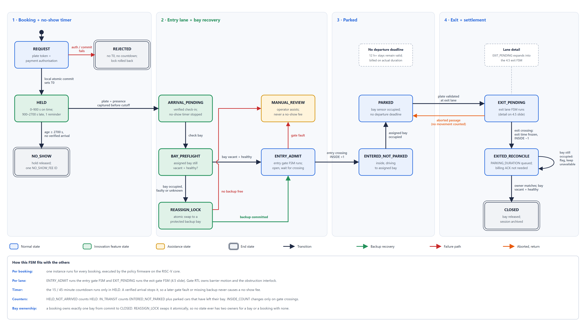

# Slide replacement content

Paste-ready content for the submitted PowerPoint, in challenge order 4.1 to 4.7. Page numbers refer to `ReservePark_Flexible_Parking_Duration_Preview.pdf`, the source the current deck is built from.

Everything here is aligned to the generated diagrams in `docs/diagrams/`. The 4.1 block diagram is the anchor: 4.2 has one row per block, 4.3 groups signals by the external boxes in the diagram, and 4.5 to 4.7 use the same state names as the FSM diagrams. Authoritative tracking stays in `docs/PRD.md` sections 8, 8.1, 8.2 and 15.1.

| Slide | Replaces preview page | Asset | Marks |
| --- | --- | --- | ---: |
| 4.1 Block diagram | 7 | `diagrams/block_diagram_4_1.png` | 10 |
| 4.2 Subsystems | 8 | Table below | 10 |
| 4.3 Interfaces | 9 | Tables below | 10 |
| 4.4.1 Non-volatile memory | 10 | Table below | 3 |
| 4.4.2 Registers | 11, 20-30 | Map and corrections below | 7 |
| 4.5 FSMs | 12, 13, 14, 32 | `overall_fsm.png`, `entry_fsm.png`, `exit_fsm_4_5.png` | 15 |
| 4.6 Validation | 16 | Tables below | 10 |
| 4.7 DFx | 17 | Content below | 5 |

---

## 4.1 Block diagram — preview page 7

Title: `4.1 | Proposed top-level SoC block diagram`
Subtitle: `External app/payment are outside chip; every internal block sits on the on-chip interconnect`
Kicker: `RESERVEPARK SoC | INTEL UNIVERSITY VLSI BOOTCAMP 2026 4.1 BLOCK DIAGRAM`

Insert `docs/diagrams/block_diagram_4_1.png` (3840×2160) or the editable `block_diagram_4_1.svg`.


Speaker notes, matching the diagram exactly:

```
ABOVE THE BUS (each linked to the bus)
  RISC-V CPU            PicoRV32 RV32I, runs policy firmware
  Program/data RAM      64 KiB, firmware + records
  Register file + IRQ   R0–R17 + extensions, sticky faults (RW1C)
  RTC + deadlines       logical seconds, 15 / 45-minute checks
  Debug trace + DFx     event trace buffer, maintenance test injection   <-> JTAG / debug port
  NVM journal           bookings, timestamps, fee IDs, audit log        <-> NVM storage (external flash)
  Network / payment     RX / TX mailboxes                                <-> app + cloud via LAN / Wi-Fi gateway

INTERNAL INTERCONNECT  PicoRV32 native memory bus + address decoder
                       RAM 0x0000_0000 · MMIO 0x1000_0000 · Journal 0x2000_0000

BELOW THE BUS (each linked to the bus)
  ACPR interface*       plate token + valid, black-box IP               <-  entry + exit cameras
  Input qualifier       2-stage sync + debounce                          <-  lane + bay sensors
  Bay counters          PHYS_OCC · INSIDE · BOOKABLE · BACKUP
  Bay allocator         atomic ownership + protected backup pool
  Entry gate FSM        passage + timestamp, obstruction interlock
  Exit gate FSM         passage + timestamp, obstruction interlock
  Motor + display*      barrier drivers, kiosk + alarm                   ->  barrier motors, kiosk displays, alarm + LED

DIRECT WIRES (not via the bus)
  Input qualifier -> bay counters, allocator, entry and exit gate FSMs  (qualified sensor + limit signals)
  Entry / exit gate FSMs -> motor driver                                 (interlocked motor requests)
```

Footer: `Every block connects directly to the bus. Firmware requests moves; only RTL drives the motor, so a software bug cannot close a barrier on a car.`

What changed and why: the preview diagram had no CPU or RAM, and blocks sat near a bus bar without drawn links. This version adds the processor and memory, draws every bus link, splits the gate FSM into entry and exit instances, and shows the two direct hardware paths that keep safety independent of firmware.

---

## 4.2 Subsystems and IP functionality — preview page 8

Title: `4.2 | Subsystems and IP functionality`
Subtitle: `One row per block in the 4.1 diagram · * = black box allowed by the challenge`
Kicker: `RESERVEPARK SoC | INTEL UNIVERSITY VLSI BOOTCAMP 2026 4.2 IP BLOCKS`

| Subsystem / IP | Function | Type | Connects to (4.3) |
| --- | --- | --- | --- |
| RISC-V CPU (PicoRV32, RV32I) | Main controller. Runs policy firmware: booking checks, 15/45-minute deadlines, backup choice, billing IDs and the overall booking FSM | Processor | clk, rst_n |
| Program / data RAM (64 KiB) | Holds the firmware image, booking records and stack | Processor | internal |
| Register file + IRQ | R0–R17 plus extensions; sticky RW1C fault bits; interrupt masks | RTL | internal |
| RTC + deadlines | Logical-seconds clock; flags the 900 s and 2700 s boundaries; gated by TIME_VALID | RTL | internal |
| Debug trace + DFx | Event trace buffer, raw vs qualified sensor view, maintenance test injection | RTL | tck, tms, tdi, tdo |
| NVM journal | Commits bookings, timestamps, fee IDs and audit records to flash | RTL | nvm_* |
| Network / payment | RX/TX mailboxes for booking, payment and notification messages | RTL | net_tx, net_rx |
| ACPR interface* | Converts camera frames to a plate token plus valid/error | Black box | entry_cam_*, exit_cam_* |
| Input qualifier | Two-stage synchroniser and debounce for every sensor; feeds gates, counters and allocator directly | RTL | presence, beams, bay, limits, obstruction, assist |
| Bay counters | PHYS_OCC, INSIDE_COUNT, BOOKABLE_NOW and BACKUP_FREE (the challenge's counter) | RTL | internal |
| Bay allocator | One ownership table; atomic commit and backup swap; keeps the protected backup pool out of normal booking | RTL | internal |
| Entry gate FSM | Runs the entry FSM: passage decoding, entry timestamp, obstruction interlock | RTL | entry_* lane signals |
| Exit gate FSM | Runs the 4.5 exit FSM: passage decoding, exit timestamp, obstruction interlock | RTL | exit_* lane signals |
| Motor + display* | Barrier motor drivers, kiosk displays and alarm | Black box | entry/exit_open/close, displays, alarm |

What changed and why: the preview's "Main Controller runs entry/exit FSMs" row is replaced by the RISC-V CPU running firmware plus two dedicated gate FSM blocks. "Booking & Bay Allocator" and "Backup Pool & Recovery FSM" become one Bay allocator, because one ownership table must own both normal and backup bays. CPU, RAM and Input qualifier rows are added because the diagram shows them.

---

## 4.3 External signal interface list — preview page 9

Title: `4.3 | External signal interface list`
Subtitle: `Direction from the SoC perspective · grouped by the external boxes in 4.1`
Kicker: `RESERVEPARK SoC | INTEL UNIVERSITY VLSI BOOTCAMP 2026 4.3 INTERFACES`

| Group (4.1 box) | Signal | Width | Dir | Description |
| --- | --- | --- | --- | --- |
| Clock + reset | clk | 1 | IN | System clock |
| | rst_n | 1 | IN | Active-low reset |
| Cameras | entry_cam_d[7:0], entry_cam_pclk/hsync/vsync | 11 | IN | Entry camera pixel bus into the on-chip ACPR* |
| | exit_cam_d[7:0], exit_cam_pclk/hsync/vsync | 11 | IN | Exit camera pixel bus into the on-chip ACPR* |
| Lane + bay sensors | entry_presence / exit_presence | 1, 1 | IN | Vehicle waiting at a gate (FSM IDLE guard) |
| | entry_beam_a/b, exit_beam_a/b | 2, 2 | IN | Directional crossing beams (WAIT_PASS) |
| | bay_occupied[3:0] | 4 | IN | Bay occupancy sensors; bays 0–2 normal, bay 3 backup |
| | entry_opened/closed, exit_opened/closed | 2, 2 | IN | Barrier limit switches (OPEN and CLOSE guards) |
| | entry_obstruction / exit_obstruction | 1, 1 | IN | Lane obstruction (WAIT_CLEAR guard and CLOSE interlock) |
| | assist_btn_entry / assist_btn_exit | 1, 1 | IN | Assistance request at each kiosk; never opens a gate |
| Barrier motors | entry_open/close, exit_open/close | 2, 2 | OUT | Motor requests; close is blocked by the hardware interlock |
| Kiosk displays | entry_disp_sck/cs_n/mosi, exit_disp_sck/cs_n/mosi | 3, 3 | OUT | SPI to kiosk displays: assigned bay, status, instructions |
| Alarm + status LED | alarm, status_led | 1, 1 | OUT | Fault and emergency indication |
| App + cloud (gateway) | net_tx / net_rx | 1, 1 | OUT / IN | Serial link to the LAN / Wi-Fi gateway |
| NVM storage | nvm_sck, nvm_cs_n, nvm_mosi / nvm_miso | 3 / 1 | OUT / IN | SPI flash holding the journal |
| JTAG / debug port | tck, tms, tdi / tdo | 3 / 1 | IN / OUT | Trace and fault readout used by 4.7 |

Second table on the same slide. These are messages carried on the one net link, not separate pins:

| Message on net link | Dir | Content |
| --- | --- | --- |
| booking_request | IN | Request ID, plate token, payment authorisation |
| booking_ack | OUT | Bay ID and T0 from the local commit, or refusal |
| payment_request / payment_ack | OUT / IN | No-show fee or actual-duration fee; same transaction ID on retry |
| app_notification | OUT | Late reminder, no-show, bay reassigned to backup |
| cloud_status / bay_policy_cfg | OUT / IN | Entry/exit times and occupancy; normal/backup bay map |

Footnote for Q&A: two FSM guards have no pin because they are internal. `acpr_valid` comes from the on-chip ACPR, and `lane_clear` is computed from the beams and the obstruction sensor. In the simulation, the ACPR black box is modelled by its output (plate token plus valid), so no image processing is simulated.

What changed and why: cameras now feed the on-chip ACPR, matching the diagram, instead of an off-chip `acpr_result`. Eight network "signals" become one physical link plus a message table. NVM flash and JTAG pins are added because the diagram shows both ports. The emergency button becomes one assistance button per kiosk with no override. Beams, limits and obstruction are split per lane.

---

## 4.4 Storage and registers — preview pages 10, 11, 20-30

### 4.4.1 Non-volatile memory (page 10)

Keep the preview table, with these alignments to the NVM journal block and the FSMs:

| Data | Description |
| --- | --- |
| Booking ID + original/current bay | Auto-assignment and any ENTRY_REASSIGN swap of the same booking |
| License plate token (hashed) | Matches the ACPR result at ENTRY_VALIDATE and EXIT_VALIDATE |
| Booking / check-in / entry / exit timestamps | T0 at local commit, check-in at ENTRY_VALIDATE, entry at ENTRY_RECORD, exit at EXIT_RECORD; drives the 15/45-minute deadlines and the actual-duration bill |
| Booking state | REQUEST, HELD, ARRIVAL_PENDING, ENTERED_NOT_PARKED, PARKED, EXIT_PENDING, EXITED_RECONCILE, CLOSED, NO_SHOW, MANUAL_REVIEW |
| Payment transaction ID + status | Fee request and acknowledgement; same ID on retry prevents a repeat charge |
| Occupancy snapshot + event sequence | Restart reconciliation with the latest committed events |
| Bay role / health / current owner | Normal or backup role, sensor health and the one current owner |
| Fault / audit log | Sensor mismatch, bay unavailable, gate timeout, operator action |

Stored through the NVM journal block to external SPI flash (`nvm_*` in 4.3). Replace "encrypted ID" with "hashed plate token" unless encryption is actually specified.

### 4.4.2 Register-file map (page 11), add an Offset column

```
OFFSET  REGISTER                BITS      FIELD PURPOSE
0x00    R0 SYSTEM_CTRL          16        Enable, maintenance, booking enable, alerts
0x04    R1 SYSTEM_STATUS        16        Network, NVM, RTC ready; busy/fault state
0x08    R2 COUNT_STATUS         16        [7:0] physically occupied; [15:8] bookable now
0x0C    R3 RESERVATION_COUNT    16        [7:0] held not arrived; [15:8] in transit
0x10    R4 TIME_POLICY          16        Grace minutes = 15; no-show minutes = 45
0x14    R5 CAPACITY_CFG         16        Total bay count; max 255 in demo
0x18    R6 GATE_COMMAND         16        Entry/exit open/close command strobes
0x1C    R7 GATE_STATUS          16        Gate limit feedback, beams, sticky passage events
0x20    R8 BOOKING_STATUS       16        Selected booking match, grace/late flags, no-show
0x24    R9 IRQ_STATUS           16        Sticky fault causes, RW1C
0x28    R10 IRQ_ENABLE          16        Interrupt masks (CPU interrupts not enabled yet)
0x2C    R11 DFX_CTRL            16        Self-test, trace, maintenance-mode test injection
0x30    R12 RTC_SECONDS         32        Trusted clock; gated by R1.TIME_VALID
0x34    R13 BACKUP_POOL_CFG     16        Protected quota; recovery enable
0x38    R14 BACKUP_POOL_STATUS  16        Backup-free and backup-in-use counts
0x3C    R15 ALLOC_COMMAND       16        Assign/reassign/release commands
0x40    R16 ALLOC_STATUS        16        Commit success/conflict/failure flags
0x44    R17 BAY_ID_SNAPSHOT     16        Current bay [7:0] and original bay [15:8]
```

Field-level corrections for pages 20-30:

```
R0 SYSTEM_CTRL — add ASSIST_ENTRY_EN [4], ASSIST_EXIT_EN [5] (optional)
  Matches the challenge's R0 example and the two assist buttons in 4.3.
  RW, reset 1'b1. RSVD becomes [15:6].

R3 RESERVATION_COUNT — IN_TRANSIT [15:8]
  Was: "checked-in vehicle not yet parked / final exited"
  Now: ENTERED_NOT_PARKED plus parked cars that have left their bay. A verified
       driver still outside the gate is ARRIVAL_PENDING, not IN_TRANSIT.

R7 GATE_STATUS — ENTRY_PASSED [6], EXIT_PASSED [7]
  Was: "directional event pulse"
  Now: RW1C sticky bit set at ENTRY_RECORD / EXIT_RECORD, cleared by firmware.
       A sticky bit cannot be missed by CPU polling the way a pulse can.

R9 IRQ_STATUS
  Was: Type column "RW/W1C"
  Now: Type column "RW1C". A new event wins over a same-cycle clear.

R11 DFX_CTRL — START_MBIST [0], SENSOR_TEST_EN [2]
  Was: "secured" / authorized test injection
  Now: Maintenance-mode-only test injection through the Input qualifier.
       Not an authenticated security boundary; cannot defeat the interlock.

R12 RTC_SECONDS
  Add: a documented time-sync write path for test setup. Deadline actions
       only run once R1.TIME_VALID = 1.

R15 ALLOC_COMMAND — AUTO_ASSIGN [0], BACKUP_REASSIGN [1]
  Was: "Choose available normal bay for new booking"
  Now: Firmware selects the candidate bay; the Bay allocator revalidates and
       commits it atomically, or rejects it if sensors changed. BACKUP_REASSIGN
       is the command issued in ENTRY_REASSIGN.
```

Formatting fix across all register slides: write reset values in the challenge template style, for example `1'b0`, `8'd15`, `1'b1`, not bare `0` / `15` / `1`.

---

## 4.5 FSMs — preview pages 12, 13, 14, 32

Three aligned diagrams. Recommended slide order:

1. **Overall booking FSM** (`diagrams/overall_fsm.png`). One booking from request to close. Every arrow is labelled with the lane state that causes it. Put it just before 4.5 as the big picture.
2. **Entry FSM** (`diagrams/entry_fsm.png`). Optional extra slide. Extends the challenge's entry template and replaces the entry table on preview page 14. State table in PRD section 8.2.
3. **Exit FSM** (`diagrams/exit_fsm_4_5.png`). The required 4.5(a) answer. The 4.5(b) state table is in PRD section 8.1.




The entry and exit FSMs share one grid: IDLE, WAIT_ACPR, VALIDATE, OPEN, WAIT_PASS, RECORD, WAIT_CLEAR and CLOSE sit in the same column on both. Column 3 holds ENTRY_PREFLIGHT on entry and is empty on exit. Every guard comes from a 4.3 signal or an internal signal named in the 4.3 footnote.

Talk track: "Every booking runs the overall machine on the RISC-V core. Only five lane events move it: validate and record at entry, validate, record and finalize at exit. The timer runs only in HELD, so a verified driver is never charged a no-show fee, and the bay is swapped atomically in ENTRY_REASSIGN before the barrier opens. The two lane FSMs are mirror images; entry adds the bay check, exit adds finalize."

Rename on preview page 14: BAY_PREFLIGHT becomes ENTRY_PREFLIGHT and REASSIGN_LOCK becomes ENTRY_REASSIGN, so every slide uses the same names.

Five differences from the preview exit FSM to say out loud:

1. EXIT_RECORD is new. Exit time is captured at the crossing, not after the barrier closes.
2. EXIT_COMMIT becomes EXIT_FINALIZE. It finalises the session and bay release only.
3. Obstruction during closing stops and reopens the barrier. Only a timeout is a fault.
4. EXIT_DONE queues the cloud notification instead of waiting for it.
5. The beam check is the full four-step overlap sequence, not "A then B".

---

## 4.6 Validation plan — preview page 16

Title: `4.6 | Directed + randomized validation plan`
Subtitle: `Each test specifies a stimulus, an observable expected result, and a status`
Kicker: `RESERVEPARK SoC | INTEL UNIVERSITY VLSI BOOTCAMP 2026 4.6 VALIDATION`

```
DIRECTED TESTS
ID    STIMULUS                              EXPECTED                                          STATUS   RUN ID
D00   Reset held, then released             No policy action while held; boot signature after  PLANNED  —
D01   Book with plate; no departure time     Exactly one vacant NORMAL bay assigned; T0 stored   PLANNED  —
D02   Two simultaneous bay booking requests  Atomic locks; never issue same live bay to two      PLANNED  —
D03   T0+12 and T0+30 plate arrivals         Both accepted; latter marked late, not charged      PLANNED  —
D04   No verified arrival at T0+45           Release hold; one idempotent no-show charge         PLANNED  —
D05   Assigned bay occupied; backup free     Lock backup before barrier opens; admit to backup   PLANNED  —
D06   Assigned bay blocked; no backup free   Keep closed; assistance, never no-show fee          PLANNED  —
D07   Normal exit, no obstruction            One passage event; correct timestamp and release    PLANNED  —
D08   Obstruction asserted during closing    Close inhibited; barrier reopens; no FAULT entry    PLANNED  —
D09   Leave backup bay after 12 hours        No overstay error; actual exit logged               PLANNED  —
D10   Reset during backup swap               Journal replay; single current bay, no double hold  PLANNED  —

RANDOM TESTS
ID   RANDOM CONDITION                    PASS CRITERION
R1   Concurrent bookings + bay contention  One owner per bay; no assumed future departures
R2   Random bay sensor faults / backup     Never assign an occupied or unhealthy backup
     exhaustion
R3   Random resets, booking ages, network  Exactly-once events; no unjust fee; ledger valid
     loss
```

FSM path each test exercises, for speaker notes or a third column. Names match the 4.5 diagrams:

```
D00  CPU held in reset: no booking leaves REQUEST; all lane FSMs stay in IDLE
D01  REQUEST -> HELD (Bay allocator commits one normal bay, T0 set)
D02  Two REQUEST -> HELD with different bays, or one REJECTED; never one bay twice
D03  HELD -> ARRIVAL_PENDING via ENTRY_VALIDATE (late flag set for +30)
D04  HELD -> NO_SHOW at 2700 s; one NO_SHOW_FEE ID
D05  ENTRY_PREFLIGHT -> ENTRY_REASSIGN -> ENTRY_OPEN; swap committed before open
D06  ENTRY_REASSIGN -> ENTRY_ASSIST; booking ARRIVAL_PENDING -> MANUAL_REVIEW
D07  EXIT_VALIDATE -> ... -> EXIT_RECORD -> EXIT_FINALIZE; booking -> CLOSED
D08  EXIT_CLOSE -> EXIT_WAIT_CLEAR on obstruction (same check on ENTRY_CLOSE)
D09  PARKED for 43,200 s on the backup bay; EXIT_RECORD; backup returned at CLOSED
D10  Reset during ENTRY_REASSIGN; NVM journal replay gives one current bay (Tier C)
```

Mapping to the PRD's D00-D29 catalogue (`docs/PRD.md` section 10):

```
Slide D00 -> PRD D00         Slide D06 -> PRD D06
Slide D01 -> PRD D21         Slide D07 -> PRD D07
Slide D02 -> PRD D12         Slide D08 -> PRD D08
Slide D03 -> PRD D01, D02    Slide D09 -> PRD D22, D28
Slide D04 -> PRD D03         Slide D10 -> PRD D27 (Tier C)
Slide D05 -> PRD D05
```

This table renumbers the deck's original D1-D8. PRD section 15.2 maps the original numbering.

What changed and why: D07 normal exit and D08 obstruction are added because the FSMs now have explicit record and reopen paths to demonstrate. D00 adds the reset check from the challenge example. Status and Run ID columns let the slide show PASS or PLANNED honestly on the day.

---

## 4.7 DFx — preview page 17

Title: `4.7 | Design for Excellence / Debug & Test`
Subtitle: `Demonstrated in simulation vs. proposed for silicon`
Kicker: `RESERVEPARK SoC | INTEL UNIVERSITY VLSI BOOTCAMP 2026 4.7 DFX`

```
Issue A — bay sensor stuck HIGH/LOW
• Symptom: normal or backup bay falsely appears free, so ENTRY_PREFLIGHT
  could pass a blocked bay.
• Debug hook: raw vs qualified view in the Input qualifier, sticky
  SENSOR_ERR (R9), read out through the JTAG / debug port.

Issue B — occupancy count stuck/corrupt
• Symptom: duplicate assignment or backup count mismatch in Bay counters.
• Debug hook: Bay allocator owner table, bay IDs (R17), lock status (R16)
  and the Debug trace buffer, read out through JTAG.

Demonstrated in this simulation:
• Trace buffer (bounded event log) and sticky fault bits with W1C clear.
• Raw-vs-qualified sensor view for bay and obstruction signals.
• Maintenance-mode (R11) stimulus injection, isolated from live interlocks.

Proposed for silicon, not built in this POC:
• Scan chains and compressed test patterns through the JTAG port.
• Full memory BIST beyond a small scratch-RAM pattern test.

Ways to reduce hardware test time
• Run memory self-test and peripheral unit tests in parallel where isolated.
• Use the trace buffer to make failures observable without a scan dump.
• Test entry gate, exit gate, RTC, Input qualifier and Bay counters as separate
  blocks; retest only the failed block.

Safety rule: test injection is restricted to maintenance mode and can never
disable the live gate obstruction interlock.
```

What changed and why: the preview listed scan chains, compressed patterns and full MBIST as if built. This splits what the demo shows from what is proposed for silicon, and names the 4.1 blocks and 4.3 JTAG pins that each hook uses.

---

## Other slides — preview pages 4, 5 and bay naming

### Page 4, replace the "CONFIRM + SYNC" step

```
03 LOCAL COMMIT
Lock bay; payment authorized; T0 set by local SoC commit (not cloud-confirmed)
```

### Page 5, replace step 5

```
5 NOTIFY — Assigned bay and T0 sent to app
App displays confirmed bay
```

### Any slide using bay names like A12 / B03

```
Note: this simulation uses 4 bays — bays 0–2 normal, bay 3 protected backup.
A12/B03-style names above are the at-scale illustration only.
```

---

## Alignment checklist

Before submitting, check that these names are identical on every slide:

| Item | Use everywhere |
| --- | --- |
| Processor | RISC-V CPU (PicoRV32, RV32I) |
| Allocation block | Bay allocator (includes the protected backup pool) |
| Gate blocks | Entry gate FSM, Exit gate FSM |
| Button | Assistance button, one per kiosk; never "override" |
| ACPR | On-chip black box fed by camera pixel buses |
| Lane states | ENTRY_* and EXIT_* exactly as in the FSM diagrams |
| Booking states | REQUEST, HELD, ARRIVAL_PENDING, ENTERED_NOT_PARKED, PARKED, EXIT_PENDING, EXITED_RECONCILE, CLOSED, NO_SHOW, MANUAL_REVIEW, REJECTED |
| Recovery step | ENTRY_REASSIGN (was REASSIGN_LOCK) issuing R15 BACKUP_REASSIGN |
| Bays | Bays 0–2 normal, bay 3 backup in the simulation |

---

## Source

Tracked authoritatively in `docs/PRD.md`: section 8 (overall FSM), 8.1 (exit FSM), 8.2 (entry FSM) and 15.1 (slide corrections). Diagrams are generated by `docs/diagrams/make_diagrams.py`. If the PRD changes, update this file to match.
